# Tech Challenge Fase 3 — Predição e Inteligência Analítica para Alfabetização no Brasil

**Pós-Tech FIAP | 1IAST | Fase 3** · [](https://github.com/Fe-Biaggio/TechChallenge_3/actions/workflows/testes.yml)

Modelo supervisionado que estima, **antes da prova**, a chance de cada aluno
do 2º ano do ensino fundamental ser considerado alfabetizado. Somando os
alunos, estima também o risco de cada município ficar abaixo da própria
meta. Foi construído sobre a camada Gold da pipeline de dados da Fase 2, que
continua neste repositório e está documentada em
[`docs/fase2_pipeline.md`](docs/fase2_pipeline.md).

| | |
|---|---|
| **Pergunta** | Com o que já se sabe no início do ano letivo, dá para antecipar quais alunos e quais municípios estão em risco de não alfabetizar? |
| **Base** | 1.851.852 alunos de 2024 com prova válida, 5.517 municípios, 16 features que existem antes da prova |
| **Validação** | Teste em 1.164 municípios **nunca vistos** (com intervalo de confiança por bootstrap); validação cruzada agrupada por município; comparação pareada entre modelos; validação fora do tempo com o indicador nacional de 2025 |
| **Modelo** | Regressão Logística regularizada (C = 0,01), escolhida pela regra de 1 desvio padrão entre 3 algoritmos otimizados (+ baseline) |
| **Resultado** | ROC-AUC 0,628 no teste (IC 95%: 0,594–0,655; baseline 0,500). Priorizando os 20% de maior risco, encontra 1,45× mais alunos em risco que ao acaso (IC 95%: 1,36–1,49×) |
| **Uso** | Ranking de risco municipal; alerta de metas (backtest 2024: correlação 0,74 entre taxa prevista e real); projeção 2025 em dois cenários; perfis de municípios |

**Navegação:** [enunciado](docs/%5BIAST%5D%20-%20Tech%20Challenge%20-%20Fase%203.pdf) ·
[decisões analíticas D1–D22](docs/decisoes_analiticas.md) ·
[model card](docs/model_card.md) ·
[notebooks](#notebooks) ·
[como reproduzir](#como-reproduzir) ·
[apresentação e roteiro do vídeo](#apresentação-e-vídeo-executivo)

---

## 1. Contexto do Problema

O Compromisso Nacional Criança Alfabetizada fixou a meta de ter todas as
crianças alfabetizadas ao fim do 2º ano do ensino fundamental até 2030. O
INEP mede isso pelo **Indicador Criança Alfabetizada**: o percentual de
alunos com pelo menos 743 pontos na escala de proficiência do Saeb. O
indicador nacional subiu de 55,9% (2023) para 59,2% (2024) e 66,0% (2025),
com meta de 80% em 2030. Em 2024, 46% dos municípios ficaram abaixo da meta
que eles próprios pactuaram para a rede municipal.

O indicador agregado tem um problema de **tempo**: quando o resultado sai, o
ano letivo já acabou. Para um gestor público, a informação útil é a
antecipada, que diz onde concentrar formação, material e acompanhamento
**antes** da avaliação.

Na Fase 2 construímos a pipeline que integra microdados de alunos,
indicadores municipais, estaduais e nacional, metas, diretórios territoriais
e IDHM numa camada Gold validada. Esta fase usa essa base para fazer
predição.

## 2. Objetivo Analítico

O objetivo é uma classificação binária no nível do aluno, **`alfabetizado`
(proficiência ≥ 743) ou não**, usando só informação disponível antes da
prova do ano previsto. Com as probabilidades individuais, respondemos às
perguntas de negócio do enunciado:

| Pergunta | Onde é respondida |
|---|---|
| Quais fatores mais impactam a alfabetização? | [§7](#7-interpretação-dos-resultados): ablação por grupo de fatores + teste de hipóteses |
| Quais municípios apresentam maior risco educacional? | [§8.1](#81-municípios-de-maior-risco): ranking out-of-fold |
| Como prever municípios que podem não atingir metas futuras? | [§8.2](#82-alerta-de-metas-backtest-2024)–[§8.3](#83-projeção-2025-e-validação-fora-do-tempo): backtest 2024, validação temporal e projeção 2025 |
| Quais regiões possuem padrões semelhantes? | [§8.4](#84-municípios-e-regiões-com-padrões-semelhantes): clusters de perfil municipal |
| Quais variáveis possuem maior influência nos modelos? | [§7](#7-interpretação-dos-resultados): coeficientes, importância por permutação e SHAP |

## 3. Descrição da Base Utilizada

A fonte são as camadas Bronze, Silver e Gold geradas por
`python pipeline/executar_pipeline.py` (Fase 2, com gate de qualidade). O
dataset de modelagem é montado por
[`src/preprocessing/dataset.py`](src/preprocessing/dataset.py), que não
refaz a limpeza: ele junta o que a pipeline já validou.

O indicador municipal, o IDHM e a série nacional vêm da **Gold**. Duas
exceções, ambas tratadas e validadas pela mesma pipeline:

- **Silver, para o aluno.** O alvo é por aluno, e a Gold guarda só
  agregados (município, UF, Brasil). O aluno existe na Silver (`alunos`),
  que já passou pela limpeza e pelo gate de qualidade.
- **Bronze, para a meta.** A Silver de metas guarda só a versão mais
  recente de cada meta, revisada *depois* da prova de 2024. Usar essa
  versão seria vazamento. A meta de 2024 como foi publicada em 2023 só
  existe na Bronze (D4).

- **Unidade**: aluno do 2º ano em 2024.
- **População**: alunos presentes e com caderno preenchido, 1.851.852 de
  2.120.560 listados. Para quem faltou, o "não alfabetizado" do dado bruto
  é um rótulo administrativo, não uma medição (D5).
- **Alvo**: 59,8% alfabetizados.

**Features (16).** Todas existiam antes da prova de 2024:

| Grupo | Features | Origem |
|---|---|---|
| Histórico educacional do município (2023) | `taxa_alfabetizacao_ant`, `nivel_alfabetizacao_ant`, `participacao_ant`, `prof_media_ant`, `prof_desvio_ant`, `prof_p25_ant` | Gold, metas (versão de 2023) e microdados de 2023 agregados |
| Meta e esforço | `meta_ano` (meta de 2024 como publicada em 2023), `esforco_meta` (meta − resultado da rede municipal em 2023) | Metas (Bronze, versão de 2023) |
| Socioeconômico | `idhm_educacao`, `idhm_renda`, `idhm_longevidade` | Atlas do Desenvolvimento Humano (IDHM 2010) |
| Escola e rede | `rede_label`, `escola_n_alunos` | Lista de alunos da avaliação |
| Território e porte | `capital_uf`, `amazonia_legal`, `mun_n_alunos_ant` | Diretório de municípios + microdados de 2023 |

Os mesmos cinco grupos são usados na ablação (§7).

**Feature engineering.** As features que mais pesam no modelo foram
construídas nesta fase, não vieram prontas:

- defasagem de todo o contexto municipal para o ano anterior;
- proficiência média, P25 e desvio do município calculados dos microdados;
- esforço necessário para bater a meta;
- porte da escola;
- meta do ano na versão publicada *antes* da prova. A tabela de metas é
  revisada todo ano (D4).

### Tratamento de data leakage

Uma regra única decide o que entra (D1): **toda feature precisa existir
antes da prova do ano previsto**. A tabela mostra o que ela excluiu, com a
evidência nos dados:

| Excluído | Por quê | Decisão |
|---|---|---|
| `proficiencia` | O alvo é um corte determinístico sobre ela (máximo entre os não alfabetizados: 742,999) | D2 |
| Indicador municipal do mesmo ano | É um agregado que inclui o próprio aluno previsto | D3 |
| `presenca`, `preenchimento_caderno` | Só existem no dia da prova; definem a população, não são features | D5 |
| Histórico da escola via `id_escola` | O código é re-mascarado a cada ano: só 865 de ~37 mil pares se repetem | D6 |
| UF e região | Com um ano de treino, aprendem o choque estadual do próprio ano (vazamento no nível do estado) | D8 |
| Meta e indicador **estaduais** | São iguais para todos os municípios do estado: funcionariam como a UF, com o mesmo problema. A meta que importa para o aluno é a do seu município | D8 |

Também ficaram de fora **redundâncias**, que não são vazamento mas impedem a
leitura dos coeficientes (D7):

- `indicador_nacional` é constante dentro do ano;
- `gap_indicador_nacional` tem correlação 1,0 com a taxa municipal;
- `faixa_risco` é só uma discretização da taxa;
- `idhm` é a média geométrica dos seus três componentes (erro máximo de
  0,0005);
- `taxa_rede_municipal_ant` é exatamente `meta_ano − esforco_meta`.

Com o `idhm` e os componentes juntos, a regressão logística dava −1,19 ao
IDHM e coeficientes positivos aos componentes, que se compensavam.

As duas regras são **testadas automaticamente**:
[`tests/test_ml_pipeline.py`](tests/test_ml_pipeline.py) falha se uma coluna
proibida ou redundante virar feature, ou se algum contexto municipal não
vier do ano anterior.

**O caso da UF não foi pego pela métrica, foi pego pela aplicação.** Com UF
como feature, a projeção de 2025 dava 27,7% de alfabetização para o Rio
Grande do Sul (o real de 2024 foi 51,6%) e marcava todos os 264 municípios
gaúchos abaixo da meta. O coeficiente do estado tinha aprendido o choque
das enchentes de 2024, que já estava no indicador defasado, e por isso o
contava duas vezes. Sem a UF, a projeção do RS ficou em 47,4%.

## 4. Análise Exploratória e Hipóteses

A EDA está em [`notebooks/04_eda_modelagem.ipynb`](notebooks/04_eda_modelagem.ipynb).
Cada achado virou uma decisão de modelagem:

| Achado | Decisão |
|---|---|
| Alvo 60/40: o baseline trivial já acerta 59,8% | ROC-AUC como métrica de escolha; sempre comparar com o baseline; sem reamostragem |
| 23% dos alunos estão em municípios sem microdados de 2023 (taxa de alfabetização de 58,5% contra 60,2%) | Imputação pela mediana **com indicador de ausência** |
| Porte de escola e de município com cauda longa (3 a 441 e 10 a 54 mil alunos) | `log1p` dentro do pipeline |
| Diferenças regionais grandes (BA 36% contra CE 85%) | Explicadas pelo desempenho defasado e pelo IDHM, não pela UF (D8) |
| Correlações simples: proficiência média do ano anterior +0,27, esforço para a meta −0,20, IDHM Educação +0,04 | Hipóteses H1–H3 |

**Hipóteses**, testadas nos notebooks 05 e 06 e respondidas em
[§7](#7-interpretação-dos-resultados) e [§8](#8-insights-e-aplicação-estratégica):

- **H1**: o desempenho educacional do município no ano anterior é o fator mais associado ao resultado do aluno.
- **H2**: indicadores socioeconômicos amplos (IDHM) pesam menos que o histórico educacional.
- **H3**: quanto maior o esforço para bater a meta, menor a chance de alfabetização.
- **H4**: o modelo é mais útil para priorizar grupos do que para prever um aluno específico.
- **H5**: existem municípios com alfabetização alta apesar de contexto socioeconômico desfavorável.

## 5. Etapas de Modelagem

Cada candidato é um único `sklearn.Pipeline`
([`src/modeling/pipeline.py`](src/modeling/pipeline.py)). O
pré-processamento faz parte do modelo e é aprendido só com os dados de
treino de cada fold:

| Etapa | Linear (Regressão Logística) | Árvores (RF / HistGradientBoosting) |
|---|---|---|
| Categórica (`rede_label`) | imputação "Desconhecido" + One-Hot (`handle_unknown="ignore"`) | imputação + `OrdinalEncoder` (categoria nova vira −1); o HGB usa o suporte nativo a categóricas |
| Contagens | mediana + `log1p` + padronização | mediana + `log1p` |
| Numéricas | mediana + indicador de ausência + padronização | mediana + indicador de ausência |

### Desenho da validação

```
1.851.852 alunos de 2024
 ├── 20% dos MUNICÍPIOS → TESTE (370.330 alunos, 1.164 municípios)
 │                         isolado de toda escolha; avalia o modelo escolhido uma vez
 └── 80% → TREINO (1.481.522 alunos, 4.353 municípios)
       ├── subamostra de 300 mil → VALIDAÇÃO por CV agrupada:
       │     ├── busca de hiperparâmetros — HGB (15 configs) e Logística (5 valores de C), 3 folds
       │     └── comparação dos 4 candidatos, 5 folds (treino × validação, comparação pareada)
       └── vencedor retreinado no treino completo → avaliado no TESTE (+ bootstrap por município)
 + predições out-of-fold em todos os alunos (5 folds agrupados) → ranking e backtest de metas
 + modelo final com todos os alunos de 2024 → projeção 2025 → comparada com o Brasil 2025 oficial
```

**Treino, validação e teste**, como pede o enunciado:

- **Treino**: 80% dos municípios.
- **Validação**: os folds da validação cruzada agrupada dentro do treino, que
  servem para escolher hiperparâmetros e modelo. O HGB usa ainda uma fração
  interna para o early stopping.
- **Teste**: os outros 20% dos municípios, que não participam de nenhuma
  escolha.

Depois da escolha, o teste foi usado mais uma vez, numa checagem de
sensibilidade documentada (D21) que não alterou o modelo.

- **Validação cruzada agrupada por município** (`StratifiedGroupKFold`) em
  todas as etapas. Nenhum município aparece no treino e na validação ao
  mesmo tempo, e há uma asserção no código que interrompe o treino se isso
  acontecer. Medimos o efeito: um split aleatório por aluno daria ROC-AUC
  0,6513, contra 0,6480 do agrupado. O otimismo é pequeno porque, sem UF,
  há pouca informação específica do município para o modelo "decorar".
- **Replicabilidade verificada**: `random_state` fixo em todo split,
  subamostra e modelo. O treino completo roda com um comando
  (`python -m src.modeling.treinar`), e os notebooks leem os artefatos em
  vez de re-treinar. Teste feito: clone limpo do repositório → pipeline
  (52 s) → suíte de testes → treino completo, com **números idênticos** aos
  publicados (escolha do modelo, métricas de teste, OOF, backtest,
  projeções e clusters). A suíte de testes roda a cada push no GitHub
  Actions ([`.github/workflows/testes.yml`](.github/workflows/testes.yml)).
- **Estratégias de otimização e contra overfitting**:
  - busca de hiperparâmetros em validação cruzada agrupada para os dois
    modelos com hiperparâmetros relevantes: `RandomizedSearchCV` no HGB
    (taxa de aprendizado, número de folhas, mínimo de amostras por folha, L2,
    profundidade) e `GridSearchCV` na força da regularização L2 da
    logística (C de 0,001 a 10 → **C = 0,01**);
  - early stopping no HGB;
  - gap entre treino e validação reportado para cada candidato;
  - regra de 1 desvio padrão para escolher o modelo (D13–D14).

## 6. Escolha do Algoritmo e Métricas

### Comparação (validação cruzada agrupada por município, 5 folds)

| Modelo | ROC-AUC validação | ROC-AUC treino | Gap treino−validação | Tempo de fit |
|---|---|---|---|---|
| Baseline (prevalência) | 0,500 ± 0,000 | 0,500 | 0,000 | < 1 s |
| **Regressão Logística** | **0,648 ± 0,016** | 0,652 | **0,004** | 1 s |
| Random Forest | 0,651 ± 0,015 | 0,687 | 0,036 | 11 s |
| HistGradientBoosting (tunado) | 0,652 ± 0,017 | 0,685 | 0,033 | 16 s |

Melhores configurações:

- **HGB**: `learning_rate=0.03`, `max_leaf_nodes=31`,
  `min_samples_leaf=2000`, `l2_regularization=0.1`
  ([`reports/tuning_hist_gradient_boosting.csv`](reports/tuning_hist_gradient_boosting.csv)).
- **Logística**: `C=0.01`. Todos os valores de C ficam a menos de 0,0001 um
  do outro: com 1,48 M alunos e 16 features não há regime de overfitting a
  conter ([`reports/tuning_regressao_logistica.csv`](reports/tuning_regressao_logistica.csv)).

**Escolhida: Regressão Logística.** Os três modelos ficam a 0,004 de
ROC-AUC uns dos outros, uma diferença 4× menor que o desvio entre folds, e
os modelos de árvore têm gap entre treino e validação 9× maior. Pela regra
de 1 desvio padrão (D14), definida antes de olhar o teste, fica o mais
simples. Ele também é o mais interpretável e o mais rápido de retreinar a
cada nova divulgação do INEP.

**Validação estatística da escolha (D21).** Como os candidatos foram
avaliados nos *mesmos* folds, dá para compará-los fold a fold:

| Diferença de ROC-AUC (mesmos folds) | Média | IC 95% | Folds em que o modelo complexo vence |
|---|---|---|---|
| HistGradientBoosting − Logística | +0,0040 | [+0,0019; +0,0061] | 5 de 5 |
| Random Forest − Logística | +0,0033 | [+0,0009; +0,0057] | 5 de 5 |

Os modelos de árvore são **consistentemente** um pouco melhores: a diferença
é estatisticamente detectável, mas pequena. Para medir se ela muda alguma
decisão, o HGB foi avaliado no mesmo teste numa checagem posterior
([`reports/sensibilidade_modelo.json`](reports/sensibilidade_modelo.json)):

| No teste | Logística | HGB |
|---|---|---|
| ROC-AUC | 0,628 | 0,634 |
| Lift dos 20% de maior risco (alunos) | 1,452× | 1,454× |
| Correlação taxa prevista × real (municípios) | 0,73 | 0,77 |

Os dois priorizam os mesmos alunos (lift idêntico) e 84% dos mesmos
municípios. O HGB ganha um pouco no agregado municipal. A escolha não foi
revista, porque trocar de modelo depois de ver o teste invalidaria o teste.
O HGB fica registrado como **modelo desafiante**: na próxima rodada, com os
dados de 2025, os dois são comparados de novo fora do tempo.

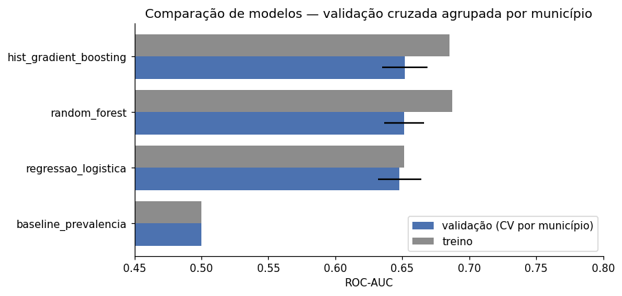

### Resultado no teste (municípios nunca vistos)

| Métrica | Modelo | Baseline (prevalência) |
|---|---|---|
| ROC-AUC | **0,628** | 0,500 |
| Average precision | 0,708 | 0,598 |
| Brier score (menor é melhor) | **0,229** | 0,240 |
| Acurácia | 0,630 | 0,598 |
| Precisão da classe "em risco" | 0,573 | n/a |
| Recall da classe "em risco" (limiar 0,5) | 0,311 | 0,000 |

**Incerteza (D22).** Intervalo de confiança de 95% por bootstrap que
reamostra **municípios inteiros** (alunos do mesmo município não são
independentes): ROC-AUC **[0,594; 0,655]**; lift dos 20% de maior risco
**[1,36×; 1,49×]**. Os dois intervalos ficam inteiros acima do acaso.

**Generalização.** O ROC-AUC do teste (0,628) fica abaixo da validação
cruzada (0,648). Isso não é overfitting:

- o gap entre treino e validação dentro da validação cruzada é de só 0,004;
- a diferença de 0,02 cabe na variação entre grupos de municípios (desvio
  de 0,016 entre folds);
- a estimativa mais estável usa os 5.517 municípios, cada um previsto por
  um modelo que nunca o viu: **ROC-AUC out-of-fold de 0,645**.

O grupo de teste sorteado é, simplesmente, um pouco mais difícil que a
média.

**Por que essas métricas.**

- **ROC-AUC** (métrica de escolha) não depende de limiar nem de
  prevalência.
- **Average precision** e as métricas da classe "em risco" olham para quem
  precisa de apoio.
- **Brier score** e curva de calibração verificam se as probabilidades são
  confiáveis, condição para somá-las por município e comparar com metas.
- **Acurácia** é reportada só ao lado do baseline, porque sozinha engana.

<p>
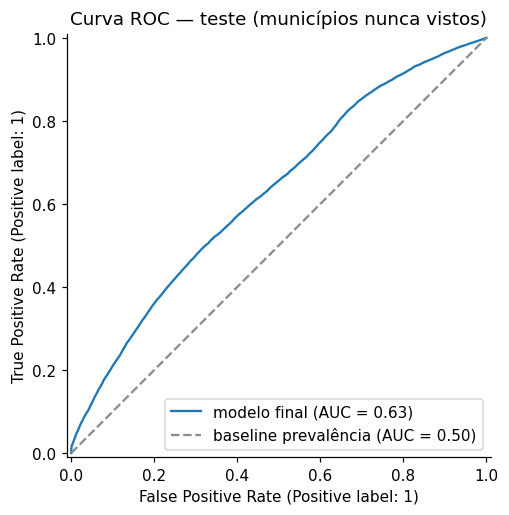
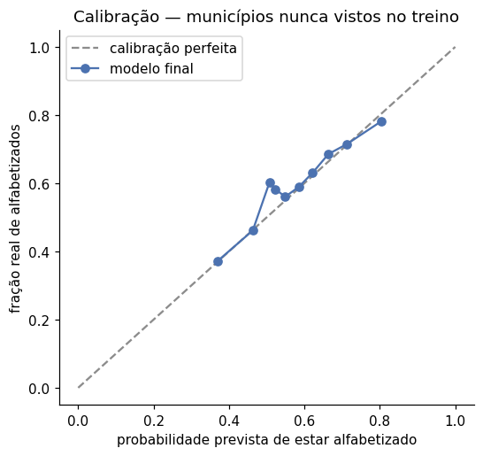
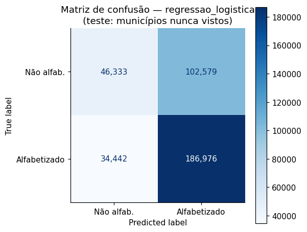
</p>

**Um ROC-AUC de 0,63 é baixo?** É o resultado esperado, e honesto, para
este problema:

- O modelo não tem **nenhuma** informação individual do aluno (frequência,
  histórico escolar, família), só o contexto do município e da escola.
  Alunos da mesma escola recebem praticamente a mesma probabilidade, e a
  variação *dentro* da escola é grande.
- Uma versão anterior deste projeto reportava 0,67, mas com split aleatório
  por aluno (otimista) e features redundantes. O número atual é menor
  porque o teste ficou mais rigoroso, não porque o modelo piorou.
- O valor de uso está no **agregado** (§8), onde os erros individuais se
  compensam: a correlação entre taxa prevista e real por município é 0,74,
  e a taxa nacional prevista para 2024 (59,3%) bate com a oficial (59,2%).

### Uso operacional: priorização

No limiar 0,5 o modelo identifica só 31% dos alunos em risco. Maximizar o
F1 da classe de risco também foi testado e descartado (D15): leva a marcar
quase todo mundo. O uso proposto é o de um programa com capacidade
limitada, que atende os X% de maior risco previsto
([`reports/analise_priorizacao.csv`](reports/analise_priorizacao.csv)):

| Atende os X% de maior risco | % do grupo de fato em risco | % de todos os alunos em risco alcançados | Lift sobre o acaso |
|---|---|---|---|
| 5% | 65,6% | 8,2% | 1,63× |
| 10% | 62,9% | 15,6% | 1,56× |
| **20%** | **58,4%** | **29,1%** | **1,45×** |
| 30% | 52,2% | 38,9% | 1,30× |
| 50% | 48,5% | 60,3% | 1,21× |

A média de alunos em risco é de 40,2%. O lift cai à medida que o grupo
cresce, como esperado: o modelo concentra o ganho no topo do ranking.

## 7. Interpretação dos Resultados

Quatro métodos complementares:

- **Coeficientes padronizados** (feature importance nativa do modelo
  linear): sinal e intensidade do efeito de cada feature.
- **Importância por permutação** (no teste): a queda de ROC-AUC quando cada
  feature é embaralhada. É agnóstica ao modelo e mede o impacto na métrica.
- **SHAP** (`LinearExplainer`, no teste): direção e magnitude do efeito,
  aluno a aluno.
- **Ablação por grupo** (validação cruzada agrupada): retreina o modelo sem
  cada grupo de fatores e só com ele. É robusta a features correlacionadas,
  que a permutação de uma feature isolada subestima.

<p>
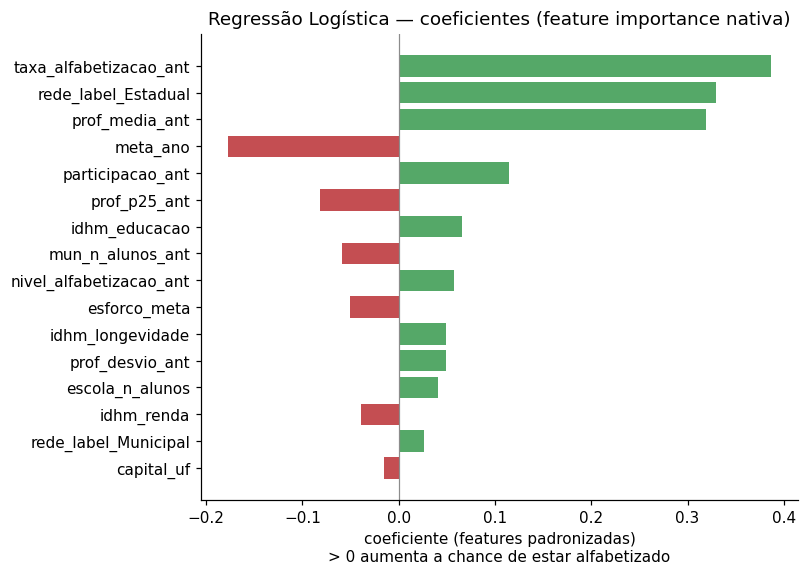
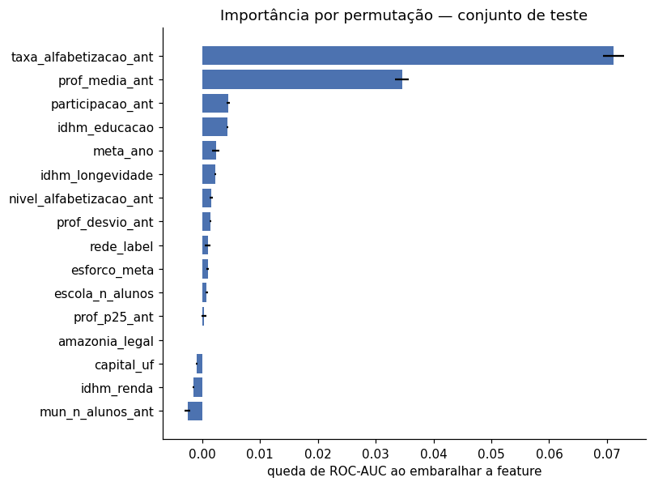
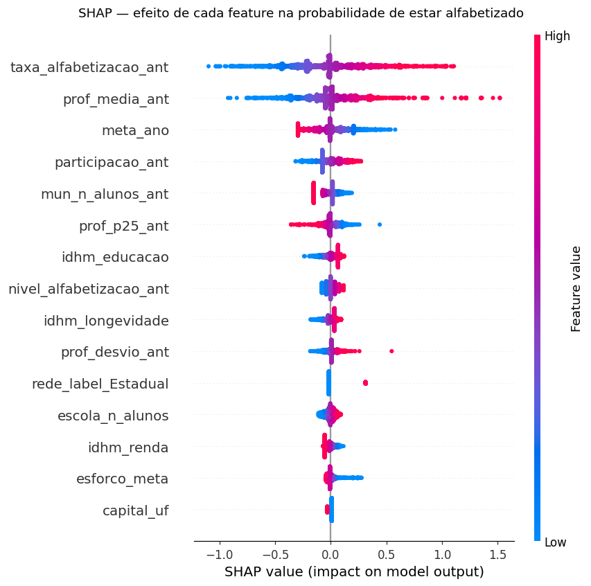
</p>

| # | Feature | Queda de ROC-AUC (permutação) | Coeficiente padronizado | Leitura |
|---|---|---|---|---|
| 1 | `taxa_alfabetizacao_ant` | 0,0711 | +0,39 | Taxa de alfabetização do município no ano anterior, de longe a mais importante |
| 2 | `prof_media_ant` | 0,0346 | +0,32 | Proficiência média do município no ano anterior |
| 3 | `participacao_ant` | 0,0045 | +0,11 | Participação na avaliação: municípios mobilizados para a prova vão melhor |
| 4 | `idhm_educacao` | 0,0044 | +0,07 | O componente do IDHM que mais pesa |
| 5 | `meta_ano` | 0,0024 | −0,18 | Negativo *dado* o resultado passado: mesma base, meta mais alta = mais distância a percorrer |

Um coeficiente que chama atenção é o da **rede estadual (+0,33)**. Com o
contexto municipal fixo, alunos da rede estadual têm chance maior que os da
municipal. Mas é justamente onde o modelo erra mais (superestima a rede
estadual, ver abaixo).

**Ablação: quais fatores mais impactam**
([`reports/ablacao_grupos_features.csv`](reports/ablacao_grupos_features.csv)):

| Grupo de fatores | Features | ROC-AUC só com o grupo | Queda de ROC-AUC ao remover o grupo |
|---|---|---|---|
| **Histórico educacional do município** (ano anterior) | 6 | **0,644** | **0,0077** |
| Meta e esforço para atingi-la | 2 | 0,628 | 0,0001 |
| IDHM (socioeconômico) | 3 | 0,539 | 0,0002 |
| Território e porte do município | 3 | 0,535 | 0,0000 |
| Escola e rede | 2 | 0,508 | 0,0028 |
| *Todas as 16 features* | 16 | *0,648* | |

O histórico educacional do ano anterior, **sozinho**, entrega 0,644 dos
0,648 do modelo completo. O IDHM sozinho fica em 0,539. A meta chega a
0,628 sozinha porque é calculada a partir do histórico, então carrega a
mesma informação (por isso removê-la quase não custa nada). Escola e rede
quase nada sozinhas, mas somam ao histórico: rede estadual e porte da
escola diferenciam alunos *dentro* do mesmo município.

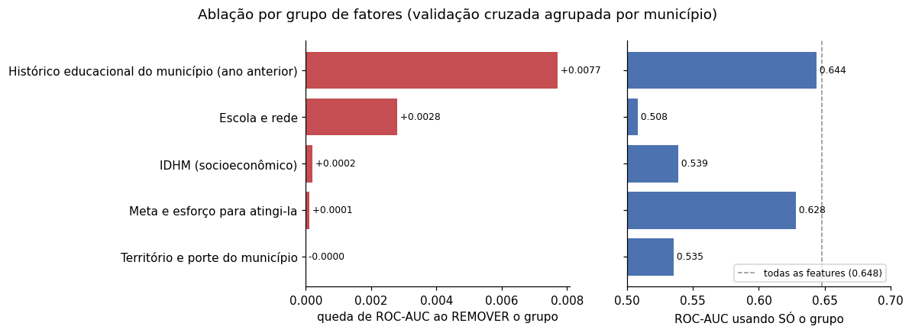

**Teste das hipóteses**

| Hipótese | Resultado | Evidência |
|---|---|---|
| **H1** Histórico educacional é o fator mais associado | ✅ Confirmada | As duas features mais importantes são resultado e proficiência do ano anterior; sozinho, o grupo entrega ROC-AUC de 0,644 (de 0,648) |
| **H2** IDHM pesa menos que o histórico educacional | ✅ Confirmada | Permutação somada: históricos 0,114, IDHM 0,005 (22×); ablação: IDHM sozinho 0,539 contra 0,644 do histórico |
| **H3** Mais esforço para a meta, menor chance | ⚠️ Na direção, fraca | Coeficiente negativo (−0,05), mas a correlação simples de −0,20 é explicada sobretudo pelo resultado passado |
| **H4** Mais útil para priorizar que para prever um aluno | ✅ Confirmada | ROC-AUC individual de 0,63 contra correlação de 0,74 no agregado municipal ([§8.2](#82-alerta-de-metas-backtest-2024)) |
| **H5** Alfabetização alta com contexto desfavorável | ✅ Confirmada | O perfil de maior alfabetização tem IDHM menor que o intermediário ([§8.4](#84-municípios-e-regiões-com-padrões-semelhantes)) |

H2 não quer dizer que a condição socioeconômica não importa. Ela já está
embutida no resultado educacional passado do município. Para prever o ano
seguinte, o histórico educacional carrega quase toda a informação que o
IDHM traria, e mais.

**Cuidados de leitura**

- Features correlacionadas dividem o efeito entre si. Por exemplo,
  `prof_p25_ant` tem sinal SHAP negativo *dado* `prof_media_ant`. Esses
  sinais parciais não devem ser lidos isoladamente.
- `mun_n_alunos_ant`, `idhm_renda` e `capital_uf` têm importância por
  permutação levemente negativa no teste. A ablação em validação cruzada (sem
  olhar o teste) confirma: o grupo "território e porte" não acrescenta nada
  (perda 0,0000). Foi mantido nesta versão para não mudar o modelo depois
  da avaliação; é o primeiro candidato a remoção na próxima
  ([§11](#11-possíveis-evoluções-futuras)).

**Onde o modelo erra mais** ([`reports/desempenho_por_nome_regiao.csv`](reports/desempenho_por_nome_regiao.csv)):

| Região | Alunos no teste | Taxa real | Taxa prevista | ROC-AUC |
|---|---|---|---|---|
| Nordeste | 108.262 | 54,0% | 55,1% | 0,668 |
| Sul | 55.031 | 63,1% | 66,3% | 0,614 |
| Centro-Oeste | 24.057 | 67,6% | 63,6% | 0,607 |
| Norte | 28.237 | 51,8% | 51,0% | 0,606 |
| Sudeste | 154.743 | 62,9% | 57,5% | 0,582 |

Sem UF entre as features, ficam vieses regionais residuais: o modelo
subestima o Sudeste em 5,4 p.p. e superestima o Sul em 3,2 p.p. Na rede
estadual ele também superestima (64,3% previsto contra 60,8% real) e separa
pior (ROC-AUC 0,569 contra 0,632 na rede municipal). É o custo, documentado,
de não usar uma variável que não transfere para o ano seguinte (D8).

## 8. Insights e Aplicação Estratégica

Notebook: [`notebooks/06_aplicacao_estrategica.ipynb`](notebooks/06_aplicacao_estrategica.ipynb),
gerado por `rodar_aplicacao_estrategica()` em `src/modeling/treinar.py`.
As taxas municipais são ponderadas pelo peso amostral do aluno, como no
cálculo oficial do INEP (D16). A ponderação foi validada: recalculada a
partir dos microdados, a taxa nacional de 2024 dá exatamente o número
oficial, 59,2%.

### 8.1 Municípios de maior risco

O ranking usa predições **out-of-fold**: cada município é avaliado por um
modelo que nunca viu nenhum aluno dele (D17). Entram só municípios com pelo
menos 30 alunos. O top 50 completo está em
[`reports/ranking_risco_municipios.csv`](reports/ranking_risco_municipios.csv).

| Município | UF | Alunos | Taxa prevista | Taxa real 2024 |
|---|---|---|---|---|
| Poço Branco | RN | 65 | 13,8% | 25,4% |
| Espírito Santo | RN | 72 | 16,0% | 47,1% |
| Iramaia | BA | 33 | 21,0% | 36,4% |
| Ceará-Mirim | RN | 654 | 21,2% | 34,7% |
| Entre Rios | BA | 255 | 21,4% | 32,6% |
| Cuité de Mamanguape | PB | 65 | 22,1% | 22,2% |
| Gurupá | PA | 473 | 22,1% | 38,2% |
| Jardim de Angicos | RN | 38 | 22,3% | 31,6% |
| Itanagra | BA | 53 | 22,4% | 24,5% |
| Cabaceiras do Paraguaçu | BA | 119 | 22,8% | 32,8% |

O risco está concentrado: dos 50 municípios de maior risco, 19 são da Bahia
e 14 do Rio Grande do Norte. Todos os 10 do topo tiveram taxa real abaixo
de 50% em 2024, contra 59,2% no país.

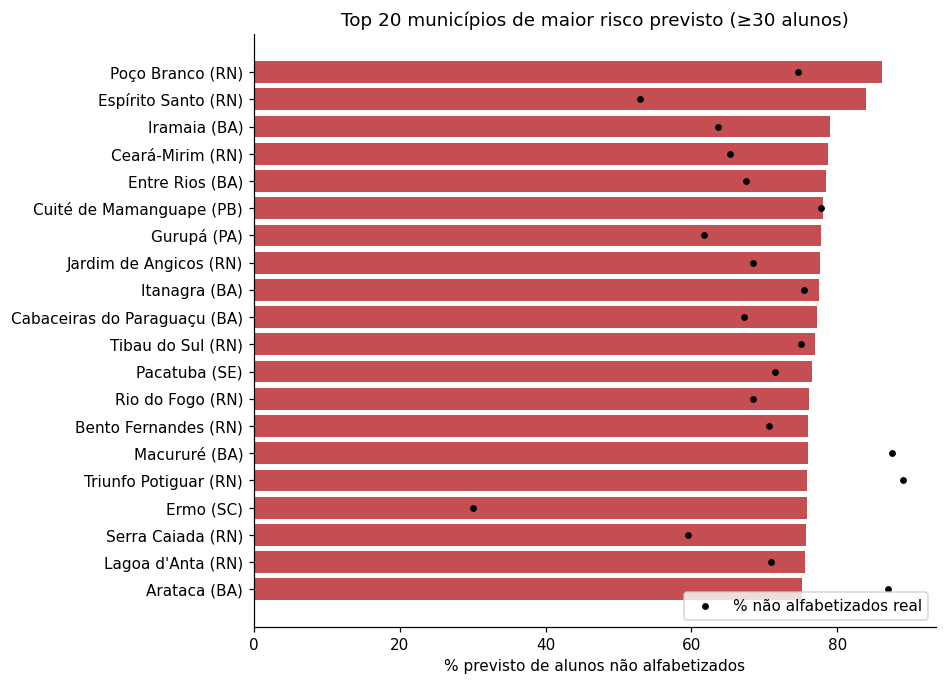

### 8.2 Alerta de metas: backtest 2024

A pergunta é se o modelo teria antecipado quais municípios ficariam abaixo
da meta de 2024. O backtest usa a rede municipal (o escopo das metas
municipais), predição out-of-fold e só dados de 2023 como contexto.

| | |
|---|---|
| Municípios avaliados | 4.677 |
| Ficaram abaixo da meta (real) | 2.169 (46%) |
| Alertados pelo modelo | 2.171 |
| **Precisão do alerta** (alertados que de fato ficaram abaixo) | **61,1%** |
| **Recall do alerta** (dos que ficaram abaixo, quantos foram alertados) | **61,2%** |
| Acurácia | 64,0% (contra 54% de "ninguém fica abaixo") |
| Correlação entre taxa prevista e real | 0,742 |
| Erro absoluto médio | 9,7 p.p. |

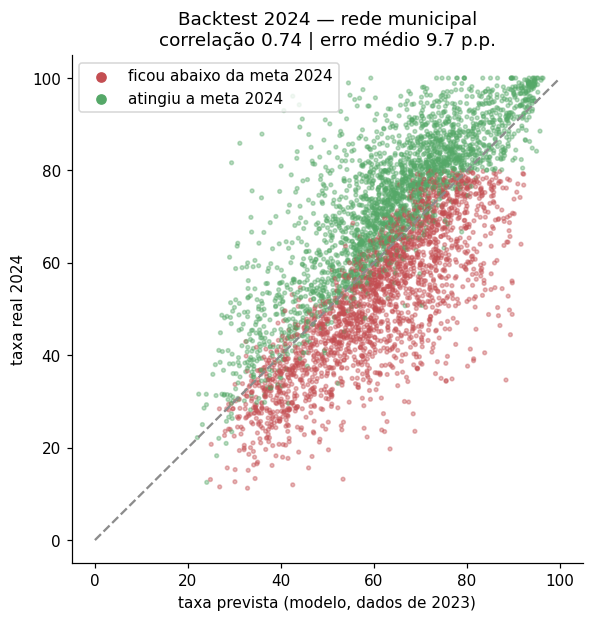

### 8.3 Projeção 2025 e validação fora do tempo

O modelo final foi aplicado ao contexto de 2024 (resultado, proficiência,
esforço para a meta de 2025), usando a composição de escolas e alunos de
2024 como aproximação (D18).

**Validação real.** Os microdados param em 2024, mas o indicador
**nacional** de 2025 já foi divulgado, e serviu para validar a projeção
fora do tempo (D20):

| | Oficial (INEP) | Modelo |
|---|---|---|
| 2024 | 59,2% | 59,3% (out-of-fold) |
| 2025 | **66,0%** | **61,1%** (projeção), erro de −4,9 p.p. |

O modelo acerta a direção, mas subestima o avanço. Ele aprendeu a relação
de um único par de anos (2023→2024, alta de 3,3 p.p.) e não tinha como
antecipar a aceleração de 2025 (alta de 6,8 p.p.).

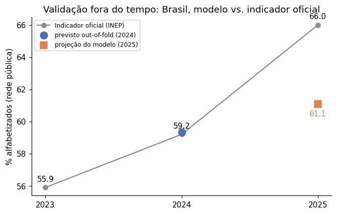

Por isso a projeção vem em **dois cenários**. O segundo desloca todas as
probabilidades por um mesmo valor em logit até a taxa nacional bater os 66%
oficiais. Isso corrige o nível sem alterar a ordem de prioridade entre
municípios:

| Região | Municípios | Abaixo da meta: modelo puro (pessimista) | Abaixo da meta: nível ajustado |
|---|---|---|---|
| Sul | 853 | 79% | 65% |
| Norte | 403 | 66% | 49% |
| Nordeste | 1.640 | 51% | 39% |
| Sudeste | 1.438 | 34% | 20% |
| Centro-Oeste | 426 | 29% | 18% |
| **Brasil** | **4.760** | **2.382 (50%)** | **1.757 (37%)** |

O Sul lidera nos dois cenários por causa do Rio Grande do Sul. Em 2024, 95%
dos municípios gaúchos ficaram abaixo da meta (taxa de 51,6% contra meta
média de 71,1%), e a meta de 2025 é ainda maior (72,4%). As listas nominais
estão em [`reports/projecao_meta_2025.csv`](reports/projecao_meta_2025.csv) e
[`reports/projecao_meta_2025_nivel_ajustado.csv`](reports/projecao_meta_2025_nivel_ajustado.csv).

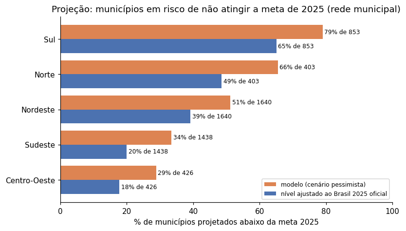

### 8.4 Municípios e regiões com padrões semelhantes

Os perfis vêm de um KMeans sobre o **perfil observado** do município, não
sobre a saída do modelo (D19): taxa, proficiência, desigualdade interna,
participação, IDHM Educação e IDHM Renda. O k foi escolhido pelo silhouette
(k = 3, silhouette de 0,27).

Um silhouette de 0,27 indica **separação moderada**: os municípios formam um
contínuo, e os perfis devem ser lidos como tendências, não como fronteiras
rígidas. O silhouette cai monotonicamente de k = 3 (0,27) a k = 7 (0,21), então
dividir mais não revela grupos mais nítidos. Para uso operacional, o ranking
de risco (§8.1) é o instrumento de priorização; os perfis servem para
encontrar pares comparáveis.

| Perfil | Municípios | Taxa de alfabetização | Proficiência média | Desigualdade interna (DP) | Participação | IDHM Educação | IDHM Renda |
|---|---|---|---|---|---|---|---|
| **C1** | 1.618 | **83,3%** | 776 | **34,4** | **94,6%** | 0,550 | 0,628 |
| **C2** | 2.013 | 62,5% | 752 | 42,8 | 88,5% | **0,638** | **0,714** |
| **C3** | 1.717 | 45,5% | 735 | 42,3 | 90,7% | 0,475 | 0,571 |

<p>
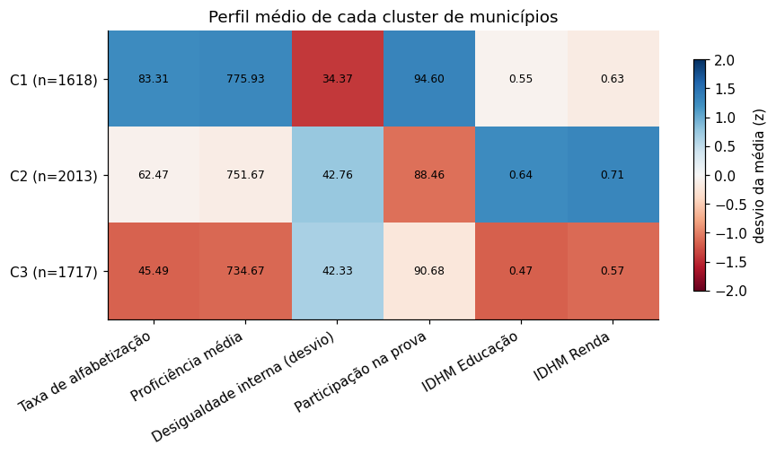
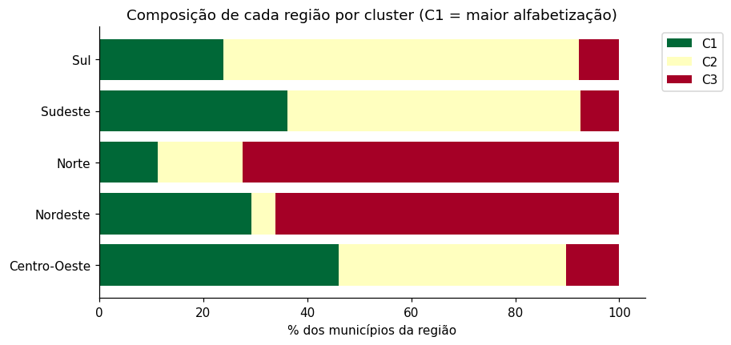
</p>

- **O perfil de maior alfabetização (C1) não é o mais rico.** O C2 tem IDHM
  Educação e Renda bem maiores e alfabetiza 21 p.p. menos. O que distingue
  o C1 é **desigualdade interna menor** e **participação maior**: escolas
  que avançam juntas, com a rede mobilizada para a avaliação.
- **Ceará**: 93,5% dos municípios do estado estão no C1, com taxa média de
  91,9% e IDHM Educação de 0,550. O estado mantém desde 2007 um programa
  próprio de alfabetização (PAIC), que serviu de referência para o
  Compromisso Nacional. É um indício forte, ainda que não seja prova
  causal, de que política educacional supera contexto socioeconômico.
- **Os padrões cruzam regiões**:
  - o C3 (maior risco) reúne 72% dos municípios do Norte e 66% do Nordeste;
  - o C2 reúne 69% do Sul e 56% do Sudeste;
  - o C1 tem presença em todas as regiões (46% do Centro-Oeste, 36% do
    Sudeste, 29% do Nordeste).

  Municípios de regiões diferentes no mesmo perfil enfrentam problemas
  parecidos e podem trocar experiências.

### 8.5 Resumo dos insights

1. **O passado educacional do município é o melhor preditor do futuro**, bem
   à frente do IDHM. As alavancas de curto prazo são de gestão educacional.
2. **Contexto desfavorável não é destino**: o perfil de maior alfabetização
   tem IDHM menor que o intermediário, e o Ceará é o exemplo mais claro.
3. **Igualdade interna e participação andam com resultado**: os municípios
   de topo têm resultados mais homogêneos entre alunos e maior adesão à
   avaliação.
4. **O risco é concentrado e identificável**: Bahia e Rio Grande do Norte
   dominam o topo do ranking, e o perfil C3 concentra o Norte e o Nordeste.
5. **O modelo serve para priorizar, não para rotular**: é fraco no aluno
   individual (ROC-AUC de 0,63) e útil no agregado (correlação de 0,74 por
   município; lift de 1,45× no top 20%).
6. **Projeções precisam de recalibração anual**: a validação com o Brasil
   2025 mostrou que o modelo não antecipa mudanças de ritmo nacionais.

## 9. Limitações

- **Nenhuma informação individual do aluno.** Frequência, histórico escolar
  e contexto familiar não existem nesta base. É o teto do ROC-AUC
  individual e o motivo de o uso recomendado ser agregado.
- **Um único par de anos** (2023→2024) para aprender a relação entre o
  contexto de um ano e o resultado do seguinte. Os microdados publicados
  cobrem só 2023 e 2024 (D9). A validação com o Brasil 2025 mostrou a
  consequência: o nível projetado ficou 4,9 p.p. abaixo do real (D20).
- **A projeção usa a composição de alunos e escolas de 2024**, porque não
  há lista de alunos de 2025 (D18).
- **O IDHM é de 2010**, o mais recente publicado no nível municipal, e
  envelhece mal em municípios que mudaram muito.
- **Associação, não causalidade.** O modelo mostra onde o risco se
  concentra, não o efeito de uma intervenção. O caso do Ceará é um indício
  a investigar, não uma prova.
- **Viés regional residual** (§7). Sem UF como feature, o modelo depende do
  desempenho defasado para representar diferenças estaduais e erra mais
  onde o ano mudou muito, como o Sudeste no teste.
- **Rede privada** praticamente ausente da avaliação (24 alunos). Nenhuma
  conclusão vale para ela.

## 10. Aplicação Prática para Políticas Públicas

1. **Priorização antes do ano letivo.** O ranking de risco indica onde
   concentrar formação de professores, material estruturado e
   acompanhamento técnico do Compromisso Criança Alfabetizada. Atender os
   20% de maior risco alcança 1,45× mais alunos em risco que uma escolha ao
   acaso.
2. **Alerta de metas.** É uma lista de municípios com risco de não atingir a
   meta do ano seguinte, gerada a tempo de pactuar apoio em vez de
   descobrir depois do resultado. No backtest de 2024, 61% dos alertas se
   confirmaram.
3. **Gestão educacional como alavanca.** O histórico educacional pesa mais
   que o IDHM (H2): práticas de gestão e pedagogia respondem em um ano
   letivo, enquanto indicadores socioeconômicos levam uma década.
4. **Cooperação entre pares.** Municípios do mesmo perfil (§8.4) em regiões
   diferentes enfrentam problemas parecidos. O perfil C1, de baixo IDHM e
   alta alfabetização, mostra onde buscar práticas replicáveis.
5. **Monitoramento anual.** A pipeline da Fase 2 atualiza a base a cada
   divulgação do INEP; o modelo reavalia o risco e recalibra o nível com o
   resultado nacional mais recente (D20).

**Uso responsável:** o modelo indica onde concentrar **apoio**, não quem
punir. Uma predição de risco não deve reduzir recursos de um município nem
rotular um aluno, porque o erro individual é alto.

## 11. Possíveis Evoluções Futuras

As duas primeiras estão planejadas na
[issue #6](https://github.com/Fe-Biaggio/TechChallenge_3/issues/6).

- **Revalidação temporal municipal.** Quando os microdados de 2025 forem
  publicados, medir o erro da projeção município a município e treinar com
  dois pares de anos.
- **Remover o grupo "território e porte"**, que a ablação mostrou não
  acrescentar nada (§7), e **reavaliar o HGB como modelo desafiante** fora
  do tempo, com os dados de 2025 (D21).
- **Censo Escolar** (infraestrutura, formação docente, turno, tamanho de
  turma): informação no nível da escola, que hoje só entra como porte.
- **CadÚnico / Bolsa Família**: vulnerabilidade no nível da família, que o
  IDHM municipal de 2010 aproxima mal.
- **Modelo hierárquico** (aluno dentro de escola dentro de município) para
  separar a variação de cada nível.
- **Piloto com uma secretaria**: priorizar municípios pelo ranking e medir o
  efeito do apoio. É o caminho para passar de associação para impacto.
- **Monitoramento de drift** na pipeline, com alerta quando a distribuição
  das features de um ano novo se afastar da de treino.

---

## Estrutura do Repositório

```
TechChallenge_3/
├── src/                                   # Fase 3 — modelo preditivo
│   ├── preprocessing/dataset.py           # Dataset nível-aluno sem vazamento (regra D1)
│   ├── modeling/
│   │   ├── pipeline.py                    # Pipelines sklearn: pré-processamento + modelo (4 candidatos)
│   │   ├── treinar.py                     # Orquestrador: split, busca, comparação, teste, OOF, projeção
│   │   ├── prever.py                      # Inferência com o modelo salvo (pontuar um ano novo sem re-treinar)
│   │   └── sensibilidade_modelo.py        # Checagem posterior: modelo desafiante (HGB) no mesmo teste (D21)
│   ├── evaluation/
│   │   ├── metricas.py                    # Métricas, priorização, subgrupos, bootstrap, comparação pareada
│   │   ├── interpretabilidade.py          # Permutação, SHAP e ablação por grupo de fatores
│   │   └── aplicacao_estrategica.py       # Ranking, backtest/projeção de metas, validação temporal, clusters
│   └── visualization/graficos.py          # 19 gráficos em images/
├── notebooks/
│   ├── 01..03_*.ipynb                     # Fase 2 — exploração, pipeline, Gold
│   ├── 04_eda_modelagem.ipynb             # EDA + hipóteses H1–H5
│   ├── 05_resultados_modelo.ipynb         # Validação, métricas, interpretação, teste de hipóteses
│   ├── 06_aplicacao_estrategica.ipynb     # Perguntas de negócio: risco, metas, validação temporal, clusters
│   └── _gerar_notebooks_fase3.py          # Gera 04–06 (leem artefatos, não re-treinam)
├── images/                                # Gráficos gerados pelo treino (01–19)
├── models/modelo_final.joblib             # Pipeline final (pré-processamento + modelo)
├── reports/
│   ├── metricas_modelo.json               # Todas as métricas do treino
│   ├── aplicacao_estrategica.json         # Backtest, validação temporal, projeções e clusters
│   ├── *.csv                              # Comparação, tuning, priorização, importância, ranking, projeções, clusters
│   └── presentation/                      # Deck da Fase 3 (+ gerador); deck e vídeo da Fase 2
├── docs/
│   ├── decisoes_analiticas.md             # D1–D22: o porquê de cada decisão, com evidência
│   ├── model_card.md                      # Ficha do modelo: uso pretendido, dados, desempenho, limites, riscos
│   ├── roteiro_video_fase3.md             # Roteiro do vídeo executivo (≤ 5 min)
│   ├── fase2_pipeline.md                  # Documentação da pipeline de dados (Fase 2)
│   ├── fase2_consultas_bigquery.md        # Consultas SQL de referência (Base dos Dados)
│   ├── arquitetura/                       # Diagramas da pipeline
│   └── [IAST] - Tech Challenge - Fase 3.pdf
├── pipeline/, quality/                    # Fase 2 — Bronze → Silver → Gold com gate de qualidade
├── data/                                  # raw/ versionado; bronze/silver/gold/modelagem gerados (ver data/README.md)
├── tests/                                 # pytest — pipeline (Fase 2) + ML (vazamento, modelos, aplicação)
├── .github/                               # CI (GitHub Actions roda os testes a cada push/PR) + template de PR
├── requirements.txt
└── README.md
```

## Como Reproduzir

```bash
pip install -r requirements.txt

# 1. Base (Fase 2): Bronze → Silver → Gold, com gate de qualidade
python pipeline/executar_pipeline.py

# 2. Testes: vazamento, redundância, pré-processamento, métricas, aplicação estratégica
python -m pytest tests/ -q

# 3. Treino completo + aplicação estratégica (~18 min nesta máquina)
python -m src.modeling.treinar
#    só refazer ranking/metas/clusters a partir das predições salvas (~1 min):
python -m src.modeling.treinar --so-estrategia

# 4. Notebooks (leem os artefatos, não re-treinam)
jupyter lab notebooks/

# 5. Inferência com o modelo salvo (ex.: projeção 2025 com o nível ajustado ao Brasil oficial)
python -m src.modeling.prever --ano-alvo 2025 --taxa-nacional 66.0

# 6. Deck da Fase 3 + roteiro do vídeo (números lidos dos artefatos)
python reports/presentation/gerar_apresentacao_fase3.py
```

**Microdados de alunos.** O CSV (~214 MB) excede o limite do GitHub e não
está versionado:

1. Baixe a tabela `alunos` em
   [Base dos Dados — Avaliação da Alfabetização](https://basedosdados.org/dataset/073a39d4-89cf-4068-b1e8-34ed0d9c0b72).
2. Salve como `data/raw/br_inep_avaliacao_alfabetizacao_alunos.csv`. Os
   outros 7 CSVs já estão no repositório.

Sem esse arquivo a pipeline roda, mas o dataset de modelagem precisa dos
microdados. Com credenciais GCP, a pipeline lê direto do BigQuery
([detalhes](docs/fase2_pipeline.md#fontes-de-dados)).

<a id="notebooks"></a>
## Notebooks

| Notebook | Conteúdo |
|---|---|
| [04_eda_modelagem](notebooks/04_eda_modelagem.ipynb) | Alvo, ausentes, associação com o alvo, transformações, território → hipóteses H1–H5 |
| [05_resultados_modelo](notebooks/05_resultados_modelo.ipynb) | Pipeline, desenho da validação, busca, comparação, teste, calibração, priorização, interpretabilidade, H1–H3 |
| [06_aplicacao_estrategica](notebooks/06_aplicacao_estrategica.ipynb) | Ranking de risco, backtest de metas, validação fora do tempo, projeção em dois cenários, checagem por UF, clusters, H4–H5 |

## Apresentação e Vídeo Executivo

- **Deck**: [`reports/presentation/Alfabetizacao_Fase3_Apresentacao.pptx`](reports/presentation/Alfabetizacao_Fase3_Apresentacao.pptx).
  São 10 slides na identidade visual do deck da Fase 2, com gráficos nativos
  (editáveis no PowerPoint), e a **fala de cada slide nas notas do
  apresentador**.
- **Roteiro do vídeo**: [`docs/roteiro_video_fase3.md`](docs/roteiro_video_fase3.md).
  Traz a fala exata de cada slide, com tempo de início e duração (~4 min 34 s,
  dentro do limite de 5 min). Cobre os quatro pontos pedidos: problema
  educacional, principais insights, valor estratégico e apoio a políticas
  públicas. Inclui dicas de gravação e respostas para perguntas prováveis.
- **Como são gerados**: deck e roteiro saem do mesmo script
  (`python reports/presentation/gerar_apresentacao_fase3.py`). Todos os
  números são lidos dos artefatos do treino, então slide, fala e README não
  divergem.
- **Vídeo**: *a gravar a partir do roteiro e do deck acima* ([issue #5](https://github.com/Fe-Biaggio/TechChallenge_3/issues/5)).

## Organização do Trabalho (Git)

O desenvolvimento foi feito em branches com Pull Requests encadeados, sem
push direto na `main` depois da base inicial:

| PR | Branch | Conteúdo |
|---|---|---|
| #1 | `fase-3/atualiza-branding` | Atualiza a identidade do projeto de Fase 2 para Fase 3 e adiciona o enunciado |
| #2 | `feature/estrutura-ml-fase3` | Primeira versão do modelo preditivo (estrutura `src/`, pipeline sklearn, SHAP) |
| #3 | `feature/melhorias-modelo-fase3` | Revisão: validação agrupada por município, correção de vazamentos (UF, redundâncias), 4 candidatos com busca de hiperparâmetros, priorização, aplicação estratégica, validação temporal, notebooks 04–06, decisões D1–D20 |
| #4 | `feature/validacao-estatistica-apresentacao` | Validação estatística (tunagem da logística, comparação pareada, bootstrap, sensibilidade), ablação por grupo, coeficientes, CI no GitHub Actions, script de inferência, model card, apresentação final e roteiro do vídeo (D21–D22) |

As decisões analíticas ficam versionadas em
[`docs/decisoes_analiticas.md`](docs/decisoes_analiticas.md), cada uma com
contexto, evidência e alternativas descartadas. Os commits referenciam a
decisão que implementam.

## Tecnologias

- **Modelo (Fase 3)**: Python 3, pandas, pyarrow, scikit-learn (Pipeline,
  ColumnTransformer, StratifiedGroupKFold, RandomizedSearchCV,
  HistGradientBoosting, KMeans), SHAP, matplotlib, Jupyter, pytest,
  python-pptx.
- **Pipeline de dados (Fase 2)**: pandas/pyarrow, BigQuery com fallback
  para CSV, simulação de streaming (fila em memória ou Kafka) e gate de
  qualidade. Detalhes em [`docs/fase2_pipeline.md`](docs/fase2_pipeline.md).
