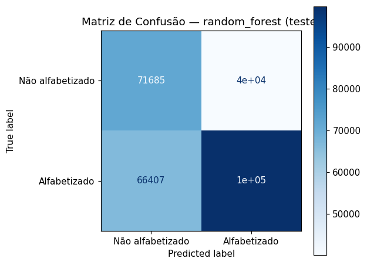
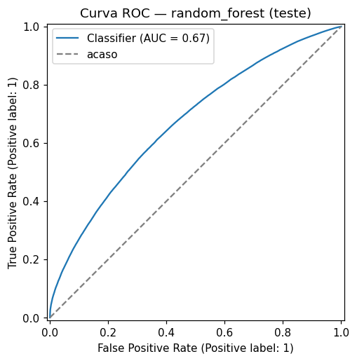
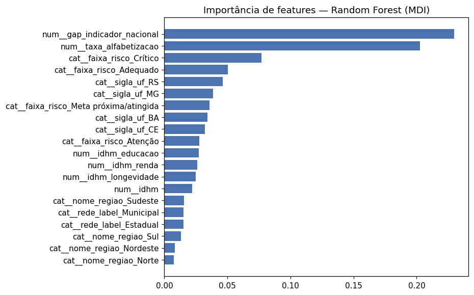
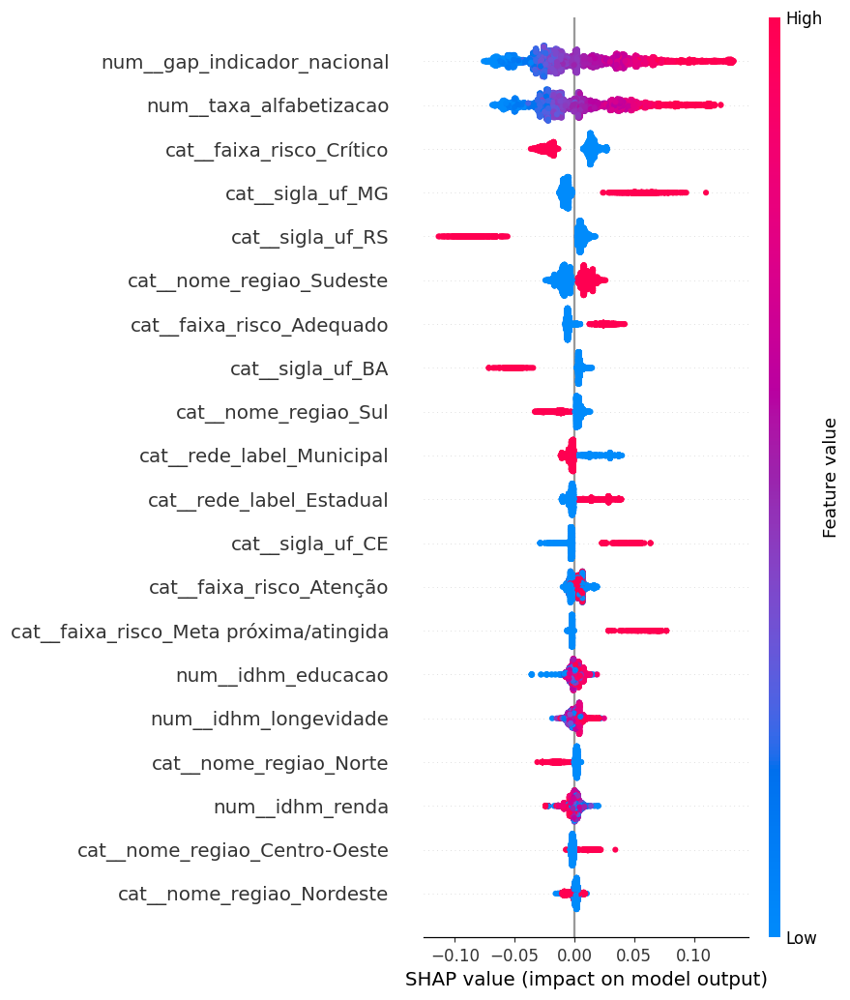

# Tech Challenge Fase 3 — Predição e Inteligência Analítica para Alfabetização no Brasil

**Pós-Tech FIAP | 1IAST | Fase 3**

Este repositório tem dois componentes que convivem de propósito:

1. **Pipeline de dados** (`pipeline/`, `quality/`) — construída na Fase 2,
   mantida como está. Produz a camada Gold a partir das fontes do INEP.
2. **Modelo preditivo** (`src/`) — novo nesta fase. Consome a Gold da
   pipeline para treinar um modelo supervisionado que prevê se um aluno
   será considerado alfabetizado, conforme pede o
   [enunciado da Fase 3](docs/[IAST]%20-%20Tech%20Challenge%20-%20Fase%203.pdf).

A documentação do item 2 vem primeiro abaixo (é o entregável desta fase);
a documentação completa do item 1 continua mais abaixo, em
["Pipeline de Dados (Fase 2)"](#pipeline-de-dados-fase-2--base-para-este-modelo).

---

# Modelo Preditivo (Fase 3)

## Contexto do Problema

A alfabetização infantil é um dos principais indicadores do desenvolvimento educacional e social do Brasil. Mas conhecer o indicador atual não é suficiente para apoiar decisão estratégica: gestores públicos precisam **antecipar** risco, identificar regiões vulneráveis e entender quais fatores mais pesam no resultado educacional — e isso exige ir além do indicador agregado, para uma predição no nível do aluno.

Na Fase 2 deste mesmo projeto, construímos a pipeline de engenharia de dados que integra o Indicador Criança Alfabetizada (INEP), metas nacionais/estaduais/municipais, dados territoriais e o IDHM (Atlas do Desenvolvimento Humano) numa camada Gold confiável. Esta fase usa essa Gold como base para ciência de dados aplicada: um modelo supervisionado.

## Objetivo Analítico

Desenvolver um **modelo de classificação binária** que prevê, para um aluno do 2º ano do ensino fundamental, se ele será considerado **alfabetizado** (proficiência ≥ 743 pontos na escala Saeb) ou **não alfabetizado**, usando apenas variáveis **territoriais, contextuais e socioeconômicas** — nunca o resultado da própria prova (ver "Tratamento de Data Leakage" abaixo).

O objetivo não é só a métrica: é identificar quais fatores mais pesam no resultado, quais municípios concentram maior risco, e como isso poderia orientar política pública (ver "Aplicação Prática para Políticas Públicas").

## Descrição da Base Utilizada

Fonte: camada Gold + Silver da pipeline da Fase 2 (`pipeline/executar_pipeline.py`), já validada pelo gate de qualidade daquele projeto — este modelo não reimplementa limpeza de dados, parte do que já está pronto.

| Fonte | Camada | O que contribui |
|---|---|---|
| `alunos` | Silver | Alvo (`alfabetizado`) + `rede_label`, por aluno |
| `indicador_alfabetizacao_municipio` | Gold | Indicador histórico do município, gap vs. indicador nacional, faixa de risco, IDHM — **defasados em 1 ano** |

Montagem completa em [`src/preprocessing/dataset.py`](src/preprocessing/dataset.py). Decisões-chave:

- **População**: só alunos com `presenca=True` e `preenchimento_caderno=True` — ~3,35M de 3,87M. Para quem faltou ou não preencheu a prova corretamente, o rótulo "não alfabetizado" é administrativo (não houve avaliação), não uma medida real de proficiência; incluir essas linhas ensinaria o modelo a prever ausência, não alfabetização.
- **Apenas ano = 2024** (~1,85M alunos): 2023 não tem "ano anterior" disponível nos dados (não há 2022), então ficaria com as 7 features municipais sempre nulas — incluir esses alunos ensinaria o modelo a ignorar essas variáveis, e um split temporal 2023→2024 treinaria sem nunca ver as features preenchidas. Ver decisão 6 em `dataset.py` para o raciocínio completo.
- **11 features finais**: `taxa_alfabetizacao`, `indicador_nacional`, `gap_indicador_nacional`, `idhm`, `idhm_educacao`, `idhm_longevidade`, `idhm_renda` (numéricas) + `faixa_risco`, `sigla_uf`, `nome_regiao`, `rede_label` (categóricas).
- **Alvo balanceado**: ~59,8% alfabetizados / 40,2% não — não precisou de reamostragem (SMOTE etc.), só `class_weight="balanced"` no classificador.

## Tratamento de Data Leakage

Dois vazamentos foram identificados e tratados — o primeiro óbvio, o segundo sutil o bastante para passar despercebido numa primeira implementação:

1. **`proficiencia` → excluída das features.** `alfabetizado` é definido por um corte determinístico sobre `proficiencia` (≥743 pontos). Confirmei isso nos dados antes de excluir, não é suposição: o maior valor de `proficiencia` entre alunos `alfabetizado=False` é 742,99; o menor entre `alfabetizado=True` é logo acima de 743. Usar `proficiencia` como feature seria prever o rótulo a partir de si mesmo.

2. **Indicador municipal do mesmo ano → defasado em 1 ano.** `taxa_alfabetizacao` na Gold é um agregado calculado *a partir dos próprios alunos avaliados naquele município naquele ano* — incluindo o aluno que estamos tentando prever. Em municípios pequenos (poucos alunos avaliados), o resultado de um único aluno pode mover o agregado de forma perceptível — uma forma sutil de vazamento por agregação circular. A correção: todo o contexto municipal usado como feature vem do **ano anterior** ao da prova do aluno (`ano_predicao = ano_indicador + 1` em `dataset.py`), quebrando a circularidade — e tornando o modelo mais realista: em produção, só o indicador do ano anterior estaria disponível no momento de prever o ano corrente.

`serie` (constante, só 2º ano) e `caderno` (código do caderno de prova, sorteado por logística de aplicação — confirmado que não é atribuído por característica do aluno) também foram excluídas por não carregarem sinal preditivo real, não por risco de vazamento.

## Etapas de Modelagem

Pipeline scikit-learn único (`src/modeling/pipeline.py`) — pré-processamento integrado ao modelo, não como passo manual separado:

1. **Imputação**: mediana para numéricas, constante `"Desconhecido"` para categóricas (ausência de contexto municipal é informação válida, não teria sentido forçar uma categoria existente)
2. **Transformação**: `StandardScaler` nas numéricas, `OneHotEncoder(handle_unknown="ignore")` nas categóricas — ignora com segurança uma categoria nunca vista no treino (ex.: rede "Federal", presente nos dados brutos mas ausente após o filtro de população)
3. **Split**: 70% treino / 15% validação / 15% teste, estratificado pelo alvo (`train_test_split` duplo)
4. **Treino + seleção de modelo**: dois candidatos treinados no mesmo split de treino, comparados no de validação (ver "Escolha do Algoritmo")
5. **Validação cruzada** (`StratifiedKFold`, 5 folds) no conjunto de treino, para garantir que o resultado não é sorte de um split específico
6. **Avaliação final** no conjunto de teste (hold-out nunca visto durante treino/seleção) — a única vez que o teste é tocado

Orquestrado por [`src/modeling/treinar.py`](src/modeling/treinar.py):
```bash
python -m src.modeling.treinar   # ~33 min em 1,85M alunos — ver "Como Reproduzir"
```

## Escolha do Algoritmo

Dois modelos candidatos, mesma pipeline de pré-processamento:

| Modelo | Por quê |
|---|---|
| Regressão Logística | Baseline interpretável por coeficiente — referência de "quão difícil" é o problema |
| Random Forest | Não-linear, captura interação entre variáveis (ex.: região × faixa de risco), `feature_importances_` nativo |

**Critério de escolha**: maior ROC-AUC no conjunto de validação (métrica robusta a desbalanceamento, mede separação entre classes independente do limiar de decisão).

| Modelo | ROC-AUC (validação) | ROC-AUC (CV 5-fold) | Desvio padrão (CV) |
|---|---|---|---|
| Regressão Logística | 0,6578 | 0,6587 | 0,0009 |
| **Random Forest** | **0,6696** | **0,6704** | **0,0008** |

Random Forest venceu, mas por margem modesta (~0,01-0,02) — sinal de que a relação entre estas features e o alvo é majoritariamente simples, um modelo não-linear ganha pouco. O desvio padrão baixíssimo entre folds nos dois modelos é o dado mais importante aqui: confirma **replicabilidade** (não é sorte de um split específico), um dos critérios explícitos do enunciado.

## Métricas de Avaliação

Resultado do Random Forest no **conjunto de teste** (hold-out nunca visto em treino ou seleção de modelo):

| Métrica | Valor |
|---|---|
| ROC-AUC | 0,6709 |
| Acurácia | 0,6168 |
| Precisão | 0,7135 |
| Recall | 0,6001 |
| F1 | 0,6519 |

ROC-AUC no teste (0,6709) praticamente idêntico ao de validação (0,6696) — a diferença de 0,0013 é bem menor que o próprio desvio padrão entre folds (0,0008), confirmando que o modelo generaliza: não houve ajuste do critério de escolha aos dados de validação às custas do teste.




## Interpretação dos Resultados

Duas técnicas de interpretabilidade, propositalmente redundantes — quando concordam, a conclusão é mais robusta que um método isolado:

- **Feature importance (MDI)**, nativa do Random Forest — [`reports/feature_importance.csv`](reports/feature_importance.csv)
- **SHAP values** (`TreeExplainer`, amostra de 5.000 alunos do teste) — [`reports/shap_importance.csv`](reports/shap_importance.csv)




**Os dois métodos concordam no topo do ranking**: `gap_indicador_nacional` e `taxa_alfabetizacao` — ambos o contexto histórico municipal defasado — dominam a predição, seguidos por `faixa_risco_Crítico`. Os componentes de IDHM aparecem bem mais abaixo no ranking, apesar de IDHM ser, isoladamente, um indicador socioeconômico mais "completo".

## Insights Encontrados

- **O histórico educacional do município prediz melhor que o IDHM.** Isso é um achado, não um dado óbvio de antemão: poderia ser o contrário (desenvolvimento humano amplo pesando mais que um indicador educacional específico). Sugere que o *como* o município já vem conduzindo a alfabetização pesa mais no resultado de um aluno novo do que o desenvolvimento socioeconômico geral daquele território.
- **ROC-AUC modesto (~0,67) é o resultado esperado, não uma falha** — depois de remover a variável que define o próprio alvo (`proficiencia`) e sem nenhuma característica *individual* do aluno disponível nestes dados (desempenho anterior, contexto familiar, frequência escolar histórica), o que resta é só contexto territorial. Um modelo que acertasse muito mais que isso com essas features seria motivo de desconfiança sobre vazamento residual, não de comemoração.
- **Rede Municipal e Estadual têm taxas de alfabetização parecidas** nesta base (majoritariamente pública) — a rede de ensino, isoladamente, não é um preditor forte.

## Limitações do Projeto

- Amostra de rede **Privada** é pequena (poucas dezenas de alunos, nesta base majoritariamente pública) — nenhuma conclusão sobre essa rede é estatisticamente confiável aqui.
- Só **2024** entra no treino/teste (ver "Descrição da Base") — com mais anos de dados publicados pelo INEP, a defasagem de 1 ano poderia ser validada em múltiplos anos (validação temporal real, não só um split aleatório dentro de um único ano).
- **Split aleatório por aluno**, não por escola/município — alunos da mesma escola compartilham fatores não capturados aqui (mesmo professor, mesma gestão); um `GroupKFold` por escola testaria generalização geográfica de forma mais rigorosa (ver "Evoluções Futuras").
- O modelo **não usa nenhuma característica individual do aluno** — não há, nestes dados, nada como desempenho em anos anteriores, frequência, ou contexto familiar. O teto de desempenho deste modelo é estrutural, não um problema de ajuste de hiperparâmetros.
- Enriquecimento com Censo Escolar, PNAD ou Cadastro Único (sugeridos no enunciado como fontes externas opcionais) não foi implementado nesta entrega.

## Aplicação Prática para Políticas Públicas

- **Priorização territorial**: `faixa_risco_Crítico` sendo o 3º fator mais importante (atrás só dos dois indicadores de resultado) dá uma lista objetiva de municípios para focar investimento — os que combinam indicador historicamente baixo com uma distância grande da meta.
- **Investir em gestão educacional municipal, não só em desenvolvimento socioeconômico amplo**: como o histórico educacional pesa mais que o IDHM, programas de melhoria de gestão/prática pedagógica municipal têm, por este modelo, mais sinal de impacto no curto prazo do que esperar indicadores estruturais de desenvolvimento subirem.
- **Monitoramento preditivo ano a ano**: como o pipeline já gera o indicador municipal anualmente (Fase 2) e este modelo consome o ano anterior como feature, o par pipeline+modelo pode reavaliar risco municipal a cada nova vintage de dados publicada pelo INEP, sem trabalho manual adicional.

## Possíveis Evoluções Futuras

- `GroupKFold` por escola/município para validar generalização geográfica de forma mais rigorosa que o split aleatório atual.
- Incorporar Censo Escolar (infraestrutura da escola) e PNAD/Cadastro Único (contexto socioeconômico familiar, não só municipal) — devem ter poder preditivo individual maior que IDHM municipal.
- Série temporal mais longa (depende do INEP publicar novos anos) para validar a defasagem de 1 ano em múltiplos anos, não só 2023→2024.
- Tunagem de hiperparâmetros (`GridSearchCV`/`Optuna`) — não foi o foco desta entrega, que priorizou a corretude da montagem do dataset (ausência de vazamento) sobre ganho marginal de métrica.
- Modelo multiclasse por `nivel_alfabetizacao` (quando disponível) em vez de binário, para graduar o risco em vez de só classificar.

---


A alfabetização na infância é um dos pilares fundamentais para o desenvolvimento educacional, social e econômico do Brasil. O **Compromisso Nacional Criança Alfabetizada** mobiliza União, estados e municípios com a meta de garantir que todas as crianças estejam alfabetizadas ao final do **2º ano do ensino fundamental até 2030**.

O INEP definiu o ponto de corte de **743 pontos na escala de proficiência do Saeb** como critério de alfabetização. Com base nisso, foi criado o **Indicador Criança Alfabetizada**, que expressa o percentual de estudantes que atingem esse patamar.

Compreender os fatores que influenciam a alfabetização exige integrar múltiplas fontes de dados — educacionais, territoriais, socioeconômicos — e disponibilizá-las de forma confiável para análise e tomada de decisão.

---

# Pipeline de Dados (Fase 2) — base para este modelo

Documentação completa do que foi entregue na **Fase 2** — a pipeline que
produz a camada Gold consumida pelo modelo acima. Mantida como estava,
sem mudanças estruturais nesta fase (só o rename de branding Fase 2 →
Fase 3 no título/rodapés, ver histórico de commits).

## O Desafio

Atuando como um **time de engenharia de dados de uma organização pública educacional**, o objetivo é construir uma **pipeline híbrida de dados (Batch + Streaming)** que integre diferentes fontes do indicador de alfabetização, garantindo qualidade, escalabilidade e eficiência de custos em ambiente de nuvem.

---

## Arquitetura da Solução

A pipeline segue a **Arquitetura Medalhão** com três camadas, com ingestão
híbrida (BigQuery com fallback automático para CSV) e streaming simulado.
Diagramas completos (arquitetura + fluxo de dados/joins) em
[`docs/arquitetura/README.md`](docs/arquitetura/README.md) — renderizam
nativamente no GitHub.

```
Fontes (BigQuery ou data/raw/*.csv)          Streaming (simulado)         Enriquecimento externo
      │                                    producer.py → consumer.py     (Atlas do Desenv. Humano)
      ▼ Batch                                       │                            │
┌─────────────┐                ┌──────────────┐     │                           │
│ Base dos    │ ─────────────► │    BRONZE    │◄────┘◄──────────────────────────┘
│ Dados       │                │ 9 tabelas    │  streaming_indicadores/
│ (INEP)      │                │ batch + 2    │  streaming_metas +
│             │                │ streaming +  │  streaming_rejeitados (auditoria)
└─────────────┘                │ 1 rejeitados │
                                └──────┬───────┘
                                       │  limpeza, decodificação de "rede",
                                       │  melt de metas, integração + IDHM
                                       ▼
                                ┌──────────────┐
                                │    SILVER    │  13 tabelas — 9 fontes tratadas + integração
                                └──────┬───────┘  + 2 streaming + 1 IDHM (linhagem própria)
                                       │  agregação analítica
                                       ▼
                                ┌──────────────┐
                                │     GOLD     │  4 datasets — 3 analíticos (com IDHM)
                                └──────┬───────┘  + 1 monitoramento de streaming
                                       │
                           ┌───────────┼───────────┐
                           ▼           ▼            ▼
                       Dashboard   Análise      Modelos ML

Qualidade (transversal) + Alertas ──valida──► Bronze / Silver / Gold
  quality/validacao_dados.py              data/monitoramento/alertas.jsonl
```

Qualidade de dados (`quality/validacao_dados.py`) valida as três camadas de
forma transversal — ver seção "Metodologia" abaixo.

**Batch vs. Streaming é o *modo de ingestão* (como o dado chega), não uma
divisão entre camadas** — os dois alimentam a Bronze, e Silver/Gold operam
sobre o que está lá independente da origem. O streaming simulado gera eventos
sintéticos (não o resultado oficial do INEP) para demonstrar o padrão de
ingestão incremental; por isso sua linhagem (`indicador_streaming`,
`meta_streaming` na Silver) fica separada da análise real, e alimenta só o
dataset de **monitoramento** na Gold, não `alfabetizacao_integrado`.

### Bronze Layer — Dados Brutos

- Ingestão sem transformação: `SELECT *` (BigQuery) ou leitura direta do CSV (fallback)
- Histórico completo preservado, um diretório por tabela
- Formato: Parquet particionado por `ano` (tabelas de referência sem partição)
- 9 tabelas batch: `indicador_municipio`, `indicador_uf`, `meta_brasil`, `meta_uf`,
  `meta_municipio`, `alunos` (~3,87M registros), `diretorio_municipio`, `diretorio_uf`,
  `idhm_municipio` (enriquecimento externo — ver seção "Fontes de Dados")
- 2 tabelas streaming (append-only, uma vez que `pipeline/streaming/04_simulacao_streaming.py`
  roda): `streaming_indicadores`, `streaming_metas`
- 1 tabela de auditoria (append-only, só existe se algum evento de streaming falhar
  na validação de schema): `streaming_rejeitados` — guarda o payload bruto e o
  motivo da rejeição (ver `pipeline/streaming/consumer.py`), em vez de descartar
  o evento inválido silenciosamente

### Silver Layer — Dados Tratados

Transformações aplicadas às tabelas batch:
- Limpeza, tipagem e padronização de nomes de colunas
- Decodificação de `rede` (código numérico → rótulo, ver `REDE_MAP` em `config.py`)
- "Despivotagem" das tabelas de meta (`meta_alfabetizacao_2024..2030`, formato
  largo) para long (`ano_meta`, `valor_meta`), mantendo por ano-alvo apenas a
  vintage mais recente publicada
- Normalização de chaves (`id_municipio`, `sigla_uf`)
- **Integração das bases**: resultado municipal + diretório (nome/UF/região) +
  meta municipal + IDHM (2010) → `alfabetizacao_integrado` (uma linha por ano × município)
- Tratamento de nulos **seletivo**: nulos estruturais (ex.: `proporcao_aluno_nivel_*`
  só existe a partir da vintage 2024; `proficiencia` nula para aluno ausente)
  não são imputados — imputar mediana nesses casos distorceria a distribuição real

As tabelas de streaming (`indicador_streaming`, `meta_streaming`) recebem
limpeza/tipagem equivalente, mas ficam fora da integração — ver nota acima.

`idhm_municipio` (enriquecimento externo) recebe limpeza e validação de domínio
(IDHM ∈ [0,1]) e entra na integração como LEFT JOIN por `id_municipio` — ver
"Fontes de Dados" para a fonte e o critério de vintage usado.

### Gold Layer — Camada Analítica

3 datasets analíticos (dado real) + 1 de monitoramento (dado de streaming):
- `indicador_alfabetizacao_municipio` — indicador por município/ano, gap vs.
  meta municipal, gap vs. indicador nacional, faixa de risco, IDHM e seus
  3 componentes (educação, longevidade, renda) quando disponível
- `comparacao_metas_resultados` — metas vs. resultados por UF/ano (rede
  Pública), com % de municípios da UF que atingiram sua meta municipal
- `evolucao_temporal` — série histórica do indicador (Brasil + UF), com
  variação ano a ano
- `monitoramento_streaming` — volume, cobertura territorial e janela temporal
  dos eventos de streaming processados (observabilidade da ingestão, não
  análise educacional)
- Os 3 primeiros ficam prontos para dashboards, análises estatísticas e
  treinamento de modelos de ML

---

## Fontes de Dados

Dataset [Avaliação da Alfabetização](https://basedosdados.org/dataset/073a39d4-89cf-4068-b1e8-34ed0d9c0b72)
(INEP, via Base dos Dados) — projeto BigQuery `br_inep_avaliacao_alfabetizacao`,
mais o diretório de referência `br_bd_diretorios_brasil`:

| Tabela | Entidade | Chave | Descrição |
|--------|----------|-------|-----------|
| `municipio` | Resultado municipal | ano, id_municipio, serie, rede | Taxa de alfabetização por município |
| `uf` | Resultado estadual | ano, sigla_uf, serie, rede | Taxa de alfabetização por UF |
| `meta_alfabetizacao_brasil` | Meta nacional | ano, rede | Trajetória de metas 2024–2030 (rede Pública) |
| `meta_alfabetizacao_uf` | Meta estadual | ano, sigla_uf, rede | Trajetória de metas por UF (rede Pública) |
| `meta_alfabetizacao_municipio` | Meta municipal | ano, id_municipio, rede | Trajetória de metas por município (rede Municipal) |
| `alunos` | Microdados | ano, id_municipio, id_escola, id_aluno | ~3,87M registros individuais de desempenho |
| `br_bd_diretorios_brasil.municipio` | Diretório | id_municipio | Nome, UF, região de cada município |
| `br_bd_diretorios_brasil.uf` | Diretório | sigla | Nome e região de cada UF |
| `atlas_desenvolvimento_humano_municipio` | Enriquecimento externo | ano, Codmun7 | IDHM e componentes (educação/longevidade/renda) por município — censos 1991/2000/2010 |

Não existe uma tabela de resultado nacional própria — a série Brasil na Gold é
derivada da coluna `taxa_alfabetizacao` já presente em `meta_alfabetizacao_brasil`.

### Limitação de dados — dicionário oficial indisponível

O dataset `br_inep_avaliacao_alfabetizacao` disponibiliza, no Base dos Dados,
uma tabela `dicionario` que traduziria oficialmente os códigos usados nas
demais tabelas — mas ela só é consultável via BigQuery, que exige projeto GCP
com faturamento ativo (indisponível nesta entrega, ver "BigQuery com fallback
para CSV" em Decisões Arquiteturais). O [link de download do
dicionário](https://basedosdados.org/api/tables/downloadTable?p=YnJfaW5lcF9hdmFsaWFjYW9fYWxmYWJldGl6YWNhbw==&q=ZGljaW9uYXJpbw==&d=ZmFsc2U=&s=)
também não pôde ser usado neste ambiente.

Sem o dicionário oficial, o significado das colunas abaixo foi **inferido** —
por convenção do INEP, pelo contexto do desafio e por validação empírica
cruzada com outras colunas — e não confirmado pela fonte oficial:

| Coluna | Valores brutos | Inferência | Base da inferência |
|---|---|---|---|
| `rede` | 0, 1, 2, 3, 4, 5 | Total, Federal, Estadual, Municipal, Privada, Pública (`REDE_MAP` em `config.py`) | Convenção padrão do INEP; `alunos` só traz 2/3/4 (redes reais por aluno), enquanto `indicador_municipio`/`indicador_uf` também trazem 0/5 — consistente com 0/5 sendo agregados, não redes reais |
| `serie` | sempre `2` | 2º ano do ensino fundamental | Contexto do desafio (o Compromisso Nacional mede alfabetização ao final do 2º ano); não há outro valor na base para comparar |
| `presenca` | 0 / 1 | Aluno ausente / presente na aplicação | `proficiencia` é 100% nula quando `presenca=0` e só 0,04% nula quando `presenca=1` — consistente com "ausente" |
| `preenchimento_caderno` | 0 / 1 | Caderno de prova não preenchido / preenchido | Mesmo padrão de `presenca`: `proficiencia` é 100% nula quando `preenchimento_caderno=0` |
| `alfabetizado` | 0 / 1 | Não atingiu / atingiu o ponto de corte de 743 pontos | Validado empiricamente contra `proficiencia`: **0 de 3.354.661** registros com proficiência preenchida contradizem o corte de 743 |

**Atenção ao usar `alfabetizado` como feature**: dos alunos com
`alfabetizado=0`, 513.338 (~13% da base de 3,87M) não têm `proficiencia`
registrada — ou seja, `alfabetizado=0` mistura "avaliado e abaixo do corte"
com "não avaliado" (mesmo código para os dois casos). Qualquer análise ou
modelo que use esse campo diretamente deve filtrar por `presenca=True`
primeiro — é exatamente por isso que `transformar_alunos()` em
`pipeline/batch/02_processamento_silver.py` não imputa `proficiencia` ausente
como se fosse zero ou mediana.

Se o acesso ao BigQuery for configurado no futuro (`GCP_PROJECT_ID` no
`.env`), a tabela `dicionario` deveria ser consultada para confirmar (ou
corrigir) essas inferências antes de qualquer uso em produção.

### Frequência de atualização da fonte

Mesmo com a pipeline estruturada para ingestão híbrida (batch periódico +
streaming simulado), a frequência real de atualização do indicador é limitada
pela própria fonte, não pela arquitetura: a página do
[dataset no Base dos Dados](https://basedosdados.org/dataset/073a39d4-89cf-4068-b1e8-34ed0d9c0b72)
registra a última atualização em **23/09/2025**, mas até esta entrega os
dados publicados ainda cobrem só **2023 e 2024** — nenhuma linha de 2025
apareceu nas tabelas de resultado (`indicador_municipio`, `indicador_uf`) ou
de alunos.

Isso é esperado, não um defeito da pipeline: o Indicador Criança Alfabetizada
vem da Avaliação de Alfabetização do Saeb, aplicada uma vez por ciclo letivo e
consolidada/publicada pelo INEP com meses de defasagem — não é um dado
transacional que muda dia a dia. A atualização de 23/09/2025 registrada na
página do dataset provavelmente reflete manutenção de cadastro/metadados, não
necessariamente novo dado de resultado.

Implicação prática: reexecutar `01_ingestao_bronze.py` com mais frequência do
que a fonte publica não traz dado novo, só custo de consulta desnecessário
(BigQuery cobra por volume escaneado — ver FinOps). O streaming implementado
(ver "Decisões Arquiteturais") já assume essa realidade: é uma simulação que
demonstra o *padrão* de ingestão incremental, não uma tentativa de capturar
eventos reais de uma fonte que, na prática, não emite eventos com essa
cadência. Em produção, o agendamento do batch deveria acompanhar o ciclo de
publicação do INEP (tipicamente anual), não uma cadência diária/horária.

### Enriquecimento externo — Atlas do Desenvolvimento Humano (IDHM)

Implementado nesta entrega. Fonte: **Atlas do Desenvolvimento Humano no
Brasil** (IPEA / PNUD / Fundação João Pinheiro), o mesmo dataset sugerido no
enunciado, disponível como dataset público no
[Base dos Dados](https://basedosdados.org/dataset/cbfc7253-089b-44e2-8825-755e1419efc8).
Sem `GCP_PROJECT_ID` configurado para consultar via BigQuery nesta entrega, os
dados foram obtidos de uma redistribuição tabular do mesmo dado oficial
(censos 1991/2000/2010), mantida em
[github.com/mauriciocramos/IDHM](https://github.com/mauriciocramos/IDHM) —
mesmo código IBGE de 7 dígitos (`Codmun7`) usado como `id_municipio` no
restante da pipeline.

- Arquivo: `data/raw/atlas_desenvolvimento_humano_municipio.csv` (16.695
  linhas — 5.565 municípios × 3 vintagens censitárias)
- Colunas usadas: `IDHM` (índice geral) e seus 3 componentes — `IDHM_E`
  (educação), `IDHM_L` (longevidade), `IDHM_R` (renda)
- **2010 é a vintage de referência** para o enriquecimento — é o último censo
  demográfico com apuração oficial do IDHM municipal (o índice depende do
  Censo Demográfico do IBGE, decenal; não há vintage 2020/2022 pública)
- Entra como enriquecimento **estático** (não varia por ano do indicador de
  alfabetização) via LEFT JOIN por `id_municipio` em `alfabetizacao_integrado`
  e na Gold `indicador_alfabetizacao_municipio`
- Cobertura real obtida: **11.021 de 11.030** registros de
  `alfabetizacao_integrado` (99,9%) — os municípios sem correspondência são
  os poucos criados/desmembrados após o Censo 2010
- Ingestão opcional: se `data/raw/atlas_desenvolvimento_humano_municipio.csv`
  não existir, a pipeline roda normalmente e essas colunas ficam ausentes —
  mesmo padrão de fallback gracioso usado nas tabelas de streaming

**Dados externos sugeridos e não implementados nesta entrega** (caminho de
evolução futura):
- Censo Escolar (INEP) — infraestrutura escolar
- IBGE Censo / PNAD — contexto socioeconômico complementar
- Cadastro Único / Bolsa Família — vulnerabilidade social
- FUNDEB — financiamento educacional

---

## Estrutura do Repositório

```
TechChallenge_3/
├── src/                                    # Fase 3 — modelo preditivo
│   ├── preprocessing/
│   │   └── dataset.py                     # Monta o dataset nível-aluno a partir da Gold/Silver, sem vazamento
│   ├── modeling/
│   │   ├── pipeline.py                    # ColumnTransformer + classificador (scikit-learn Pipeline único)
│   │   └── treinar.py                     # Orquestrador: split, treino, validação cruzada, seleção, salva tudo
│   ├── evaluation/
│   │   ├── metricas.py                    # Métricas, matriz de confusão, validação cruzada
│   │   └── interpretabilidade.py          # SHAP (TreeExplainer)
│   └── visualization/
│       └── graficos.py                    # Todos os gráficos salvos em reports/figures/
├── models/
│   └── modelo_random_forest.joblib        # Pipeline treinado (pré-processamento + modelo) — gerado
├── pipeline/
│   ├── executar_pipeline.py               # Orquestrador: Bronze->Silver->Gold com gate de qualidade
│   ├── batch/
│   │   ├── config.py                      # TABELAS, REDE_MAP, diretórios, credenciais
│   │   ├── utils.py                       # logger, I/O Parquet, métricas de qualidade
│   │   ├── 01_ingestao_bronze.py          # BigQuery com fallback → CSV raw → Bronze (+ IDHM externo)
│   │   ├── 02_processamento_silver.py     # Limpeza, melt de metas, integração → Silver
│   │   └── 03_agregacao_gold.py           # Agregações Silver → Gold
│   ├── streaming/
│   │   ├── producer.py / consumer.py      # Fila em memória ou Kafka real (+ persiste rejeitados)
│   │   └── 04_simulacao_streaming.py      # Orquestrador da simulação
│   └── monitoring/
│       └── alertas.py                     # disparar_alerta() — log + data/monitoramento/alertas.jsonl
├── data/
│   ├── raw/                               # CSVs exportados (fallback sem GCP) + metadados + IDHM
│   ├── bronze/                            # Dados brutos (Parquet) — gerado, não versionado
│   ├── silver/                            # Dados tratados e integrados — gerado, não versionado
│   ├── gold/                              # Datasets analíticos — gerado, não versionado
│   ├── gold_rejeitada/                    # Gold que reprovou no gate — gerado, não versionado
│   └── monitoramento/                     # alertas.jsonl — gerado, não versionado
├── quality/
│   └── validacao_dados.py                 # Regras de qualidade para Bronze/Silver/Gold
├── tests/                                 # pytest — pipeline (qualidade, alertas, Silver) + ML (vazamento, modelo)
├── notebooks/
│   ├── 01_exploracao_dados.ipynb          # Análise exploratória das 8 fontes raw (Fase 2)
│   ├── 02_pipeline_bronze_silver.ipynb    # Transformações, com o caso real de decisão de escopo (Fase 2)
│   ├── 03_camada_gold_analytics.ipynb     # Gráficos da Gold + aplicação em IA (Fase 2)
│   ├── 04_eda_modelagem.ipynb             # EDA do dataset de modelagem (Fase 3)
│   └── 05_resultados_modelo.ipynb         # Interpretação do modelo treinado — carrega, não re-treina (Fase 3)
├── docs/
│   ├── arquitetura/                       # Diagramas (Mermaid + PNG) e decisões (Fase 2)
│   ├── [IAST] - Tech Challenge - Fase 2.pdf  # Enunciado da Fase 2 — pipeline de dados
│   └── [IAST] - Tech Challenge - Fase 3.pdf  # Enunciado da Fase 3 — predição/ML (este modelo)
├── reports/
│   ├── metricas_modelo.json               # Métricas completas do treino (Fase 3) — gerado
│   ├── feature_importance.csv             # Ranking MDI do Random Forest — gerado
│   ├── shap_importance.csv                # Ranking |SHAP| médio — gerado
│   ├── figures/                           # 7 gráficos do modelo (EDA + resultado) — gerado
│   ├── dashboard.html                     # Painel analítico (Fase 2) — HTML autocontido, gerado
│   ├── dashboard_template.html            # Template do painel (estrutura/estilo/JS)
│   ├── dashboard_data.json                # Agregados Gold consumidos pelo painel (gerado)
│   ├── gerar_dashboard_dados.py           # Gold (+ Silver/alunos) → dashboard.html
│   └── presentation/
│       ├── Alfabetizacao_Apresentacao.pptx  # Apoio para o vídeo executivo da Fase 2 (gerado)
│       └── gerar_apresentacao.py            # dashboard_data.json → .pptx
├── requirements.txt                       # Dependências Python
├── pytest.ini                             # Configuração dos testes
└── README.md
```

`data/raw/` traz 7 dos 8 CSVs (o de `alunos`, ~214MB, excede o limite de
100MB do GitHub — ver `.gitignore`); os demais ficam versionados para que o
pipeline rode via fallback sem precisar de credenciais GCP.

---

## Metodologia

### 1. Ingestão Batch ([`pipeline/batch/`](pipeline/batch/))
Processamento sob demanda das 8 tabelas fonte (Base dos Dados) + 1 de
enriquecimento externo (IDHM), com fallback automático:
- BigQuery (produção) → CSV local em `data/raw/` se GCP não estiver configurado
- Metas educacionais (nacional, estadual, municipal), resultado (município/UF),
  diretórios de referência, microdados de alunos e IDHM municipal

### 2. Ingestão Streaming ([`pipeline/streaming/`](pipeline/streaming/))
Simulação de eventos em tempo quase real (fila em memória por padrão, ou Kafka
real se configurado), que alimenta a Bronze e segue até Silver/Gold como
linhagem própria (ver nota em "Arquitetura da Solução"):
- Atualização de indicadores municipais
- Atualização/revisão de metas
- Consumer processa em micro-lotes e persiste em Parquet append-only —
  cada execução acrescenta eventos, não substitui os anteriores

### 3. Qualidade de Dados ([`quality/validacao_dados.py`](quality/validacao_dados.py))
Valida as 3 camadas (Bronze, Silver, Gold) — 23 tabelas batch sempre (incluindo
`idhm_municipio`), +5 de streaming (2 na Bronze, 2 na Silver, 1 na Gold) se
`04_simulacao_streaming.py` já rodou, 0 alertas na última execução contra os
dados reais (28/28 tabelas OK):
- Completude (limiar de nulos por coluna, calibrado por tabela — nulos
  estruturais como `proporcao_aluno_nivel_*` pré-2024 não geram alerta)
- Unicidade (duplicatas na chave primária de cada tabela)
- Integridade referencial (`sigla_uf` de `alfabetizacao_integrado` contra `diretorio_uf`)
- Domínio (siglas de UF válidas; `taxa_alfabetizacao` ∈ [0,100]; IDHM e
  componentes ∈ [0,1] via `verificar_dominio_numerico`)

Cada alerta de qualidade dispara `disparar_alerta()` (ver seção "Monitoramento"),
não fica só no log de console.

**Importante — isto por si só não bloqueia nada.** Rodado como script
separado (como nos passos 2 e 4 de "Como Reproduzir"), `quality/validacao_dados.py`
só reporta: a Gold já foi escrita e já está disponível em `data/gold/` quando
a validação roda. Quem precisa de um gate de verdade — nenhuma Gold reprovada
disponível para consumo — usa [`pipeline/executar_pipeline.py`](pipeline/executar_pipeline.py)
(seção seguinte) em vez de rodar 01/02/03 manualmente.

### 3.1. Gate de qualidade ([`pipeline/executar_pipeline.py`](pipeline/executar_pipeline.py))

Orquestra Bronze → Silver → Gold e só publica a Gold em `data/gold/` se todas
as camadas passarem na validação:

1. Roda Bronze; valida Bronze — para antes de construir Silver se houver alerta
2. Roda Silver; valida Silver — para antes de construir Gold se houver alerta
3. Roda Gold; valida Gold — se houver alerta, **move tudo que acabou de ser
   gerado para `data/gold_rejeitada/<timestamp>/`** e encerra com código de
   saída ≠ 0. `data/gold/` nunca fica com dado que não passou no gate.

```bash
python pipeline/executar_pipeline.py
```

Testado nos dois sentidos: rodando limpo (Gold publicada, código 0) e com uma
regra de qualidade forçada a falhar (Gold movida para `gold_rejeitada/`,
`data/gold/` fica vazia, código 1) — ver histórico de commits.

### 4. Testes automatizados ([`tests/`](tests/))
24 testes `pytest` cobrindo as funções puras da pipeline (não dependem de
dados reais nem de I/O em disco fora de `tmp_path`):
- `test_qualidade.py` — as 5 verificações de `quality/validacao_dados.py`
  (completude, unicidade, domínio de UF, domínio numérico, integridade referencial)
- `test_alertas.py` — persistência e leitura de `data/monitoramento/alertas.jsonl`
- `test_silver_transformacoes.py` — padronização de colunas, decodificação de
  rede, melt de metas (long + vintage mais recente), seleção de rede headline

```bash
python -m pytest tests/ -v
```

---

## Tecnologias Utilizadas

| Tecnologia | Uso | Justificativa |
|------------|-----|---------------|
| Python 3.10+ | Pipeline principal | Ecossistema rico para dados, único runtime em todas as camadas |
| pandas + pyarrow | Transformação e I/O Parquet | ~3,87M linhas (maior tabela) cabem confortavelmente em memória (~1,1GB) — um cluster distribuído seria over-engineering neste volume |
| Parquet + Snappy | Formato de armazenamento das 3 camadas | Compressão colunar eficiente, leitura seletiva de colunas, particionamento nativo |
| `basedosdados` (BigQuery) | Ingestão em produção | Client oficial da Base dos Dados; cai automaticamente para CSV local se não configurado |
| Kafka / fila em memória | Streaming | `kafka-python` para Kafka real; fila em memória (`threading.Queue`) por padrão — roda sem infraestrutura externa |
| Jupyter + matplotlib/seaborn | Notebooks analíticos | Exploração e visualização executadas contra os dados reais da pipeline |
| python-dotenv | Configuração | Credenciais/parâmetros via `.env`, fora do controle de versão |
| pytest | Testes automatizados (`tests/`) | Funções puras da pipeline (qualidade, alertas, transformações Silver) testadas isoladamente, sem depender de `data/raw/` |

**Considerados, não usados nesta entrega** (ficam em `requirements.txt` como
caminho de evolução, não como dependência ativa do código): PySpark/Delta
Lake/Iceberg — fariam sentido se o volume de dados não coubesse em um único
processo; Great Expectations — o volume de regras de qualidade deste projeto
não justificou a curva de configuração frente a um validador Python direto
(`quality/validacao_dados.py`).

---

## Decisões Arquiteturais

### Batch vs Streaming
- **Batch** para as 8 fontes históricas (resultado, meta, diretórios, alunos) — volume conhecido, sem necessidade de latência baixa
- **Streaming simulado** para eventos de atualização de indicador/meta — demonstra o padrão de ingestão incremental sem exigir um cluster Kafka real para rodar localmente

### BigQuery com fallback para CSV, não só um ou só outro
- BigQuery é o caminho de produção (sempre atualizado, sem duplicar dados),
  mas exige projeto GCP com faturamento ativo — indisponível no ambiente de
  desenvolvimento usado nesta entrega
- `01_ingestao_bronze.py` tenta o BigQuery e cai automaticamente para `data/raw/*.csv`
  (mesmo dado, exportado uma vez) sem exigir nenhuma mudança de código — o
  restante da pipeline roda idêntico nos dois caminhos

### Escopo de rede na comparação meta x resultado
- `indicador_municipio`/`indicador_uf` trazem mais de uma rede por (ano,
  entidade); `meta_municipio` só define metas para a rede Municipal e
  `meta_uf`/`meta_brasil` só para a rede Pública (agregado)
- Comparar a meta contra o resultado "headline" (melhor rede disponível)
  misturaria escopos e geraria um gap incorreto para qualquer município com
  mais de uma rede avaliada — por isso a Silver mantém o resultado headline e
  o resultado no escopo exato da meta como colunas separadas (ver
  `notebooks/02_pipeline_bronze_silver.ipynb` para um caso real)

### Data Lake vs Data Warehouse
- Parquet particionado em disco (data lake simples) em vez de um Data
  Warehouse gerenciado — no volume atual (~415MB no total, somando raw + bronze + silver), o overhead
  operacional de um DW não se paga; a estrutura de camadas já isola dado
  bruto de dado analítico, que é o benefício que se buscaria com um DW aqui

### Custo vs Performance
- Parquet + particionamento por `ano` reduz o volume lido por consulta a um
  ano específico
- Processamento local de ponta a ponta (Bronze→Silver→Gold) roda em ~35s
  neste volume — nenhuma infraestrutura de cluster a manter ou pagar
  ociosidade

---

## FinOps — Otimização de Custos

| Prática | Impacto |
|---------|---------|
| Armazenamento em Parquet com compressão Snappy | ~54% menos espaço em disco na tabela `alunos` (99MB em Parquet vs. 214MB no CSV de origem, mesmos ~3,87M registros) — mais leitura seletiva de colunas, que o CSV não permite |
| Particionamento por `ano` | Consultas a um ano não escaneiam o histórico completo |
| Processamento local (pandas) em vez de cluster distribuído | Sem custo de cluster gerenciado (EMR/Dataproc/Databricks) nem capacidade ociosa — justificável enquanto o maior dataset (~3,87M linhas) couber em memória de um processo |
| Fallback CSV para BigQuery | Evita custo de consultas BigQuery repetidas durante desenvolvimento/reexecução — o dado é consultado uma vez e reaproveitado localmente |
| Camada Gold pré-agregada | Elimina reprocessamento de `alunos` (maior tabela) na maior parte das análises — as 3 visões de `indicador_alfabetizacao_municipio`/`comparacao_metas_resultados`/`evolucao_temporal` do dashboard leem só a Gold, já pequena. A visão "Aluno" é a exceção deliberada: agrega direto da Silver (não há rollup de aluno pronto na Gold) — mas roda uma vez em `gerar_dashboard_dados.py`, não a cada carregamento da página |

### Estimativa de custo mensal (projeção — nenhuma infraestrutura foi provisionada nesta entrega)

Cruza os números medidos da pipeline (volume real por camada, tempo de
execução real) com o preço público de lista do Google Cloud (mesmo provedor
já referenciado no caminho de ingestão via BigQuery), consultado em
outubro/2026. É explicitamente uma projeção, não uma fatura real.

**1. Preço unitário por serviço:**

| Serviço | Unidade | Quantidade medida | Preço unitário (lista) |
|---|---|---|---|
| Cloud Storage Standard (us-central1) | GB-mês | 0,41 GB — raw (219MB) + bronze (101MB) + silver (97MB) + gold (0,5MB) armazenados juntos | $0,020/GB-mês¹ |
| Cloud Run (CPU só durante a requisição) | vCPU-segundo | 78 vCPU-s/execução — 39s medidos × 2 vCPU alocados | $0,000024/vCPU-s² |
| Cloud Run (memória) | GiB-segundo | 156 GiB-s/execução — 39s medidos × 4 GiB alocados | $0,0000025/GiB-s² |
| BigQuery on-demand | TiB escaneado | ~0,0002 TiB/execução — `SELECT *` nas 8 tabelas batch ≈ volume do raw (219MB) | $6,25/TiB³ |

**2. Custo mensal projetado por cadência** (armazenamento é constante — não
depende de quantas vezes a pipeline roda; processamento e consulta escalam
com a cadência):

| Cadência | Execuções/mês | Processamento (lista) | Consulta BigQuery (lista) | + Armazenamento | **Total projetado (lista)** | Total real (com free tier)⁴ |
|---|---|---|---|---|---|---|
| Diária (pior caso, não recomendada) | ~30 | $0,0679 | $0,0392 | $0,0082 | **$0,1153** | ~$0,0082 (só armazenamento) |
| Mensal (cenário ingênuo — default comum sem olhar a fonte) | 1 | $0,0023 | $0,0013 | $0,0082 | **$0,0118** | ~$0,0082 (só armazenamento) |
| **Anual (recomendada — acompanha o ciclo de publicação do INEP, ver "Frequência de atualização da fonte")** | 1/12 | $0,0002 | $0,0001 | $0,0082 | **$0,0085** | ~$0,0082 (só armazenamento) |

O número chama atenção pelo tamanho, não pela precisão: no volume atual
(centenas de MB, execução em segundos), o custo de nuvem projetado é
irrelevante em qualquer uma das três cadências — inclusive a diária, que
ninguém está recomendando. Isso **não invalida a análise de FinOps, é o
resultado dela**: a decisão de arquitetura certa neste estágio não é
otimizar um valor em dólares que já nasce perto de zero, é não contratar
capacidade que essa carga não precisa (cluster gerenciado sempre ligado,
Kafka provisionado) — exatamente o argumento da seção "Custo vs Performance"
acima, agora com número em vez de só intuição. Isso muda na mesma proporção
em que o volume crescer: se `alunos` passar de milhões para centenas de
milhões de linhas (todos os anos/UFs do histórico completo do INEP, por
exemplo), tanto o argumento de "cabe em memória" quanto esta projeção de
custo deixam de valer e precisam ser refeitos — ver nota na seção acima.

Cadência mensal x anual: mesmo com os dois cenários custando frações de
centavo hoje, a diferença (~28% menor na cadência anual) é a mesma lógica
que, em um volume de produção real (GB/TB em vez de MB), separa uma conta de
nuvem razoável de uma inflada por reprocessar um dado que a fonte não
atualizou.

¹ [Google Cloud Storage Pricing 2026 — CloudZero](https://www.cloudzero.com/blog/gcp-storage-pricing/)
² [Cloud Run Functions Pricing 2026 — nOps](https://www.nops.io/blog/cloud-run-functions-pricing/)
³ [BigQuery Pricing — On-Demand $6.25/TiB Scanned](https://www.stackscored.com/pricing/data-warehouse/bigquery/)
⁴ Cloud Run: 180.000 vCPU-s + 360.000 GiB-s/mês grátis — até a cadência diária
(2.340 vCPU-s/mês) fica ~77× abaixo do limite. BigQuery: 1 TiB de consulta
grátis/mês — a cadência diária (~6,3GB/mês escaneados) fica ~160× abaixo do
limite. Armazenamento é o único item sem free tier generoso o bastante para
zerar com segurança neste cálculo, por isso é a única linha com custo real
projetado (fração de centavo) nos três cenários.

---

## Aplicação em IA

Esta seção, na Fase 2, descrevia o que a Gold *poderia* alimentar em IA —
na Fase 3 isso foi implementado de fato: ver
["Modelo Preditivo (Fase 3)"](#modelo-preditivo-fase-3) no topo deste
README para o modelo treinado, métricas e insights reais.

Do que foi listado na Fase 2, o que ficou de fora desta entrega (ver
"Evoluções Futuras" na seção do modelo):
- **Clusters de vulnerabilidade educacional** (k-means/hierárquico) — não implementado, a Fase 3 pediu classificação supervisionada, não clustering
- **Modelo por município** (em vez de por aluno) — o enunciado da Fase 3 pede predição a nível de aluno especificamente

---

## Como Reproduzir

### 1. Pré-requisitos

```bash
pip install -r requirements.txt
```

O pipeline roda **sem nenhuma configuração adicional**, usando os CSVs em
`data/raw/` (fallback). Para usar BigQuery em vez do fallback, copie
`.env.example` para `.env` e preencha `GCP_PROJECT_ID` — **atenção**: é o
Project ID do GCP, não o Billing Account ID da conta de faturamento (ver
comentário em `.env.example`).

### 2. Executar o Pipeline Batch

**Recomendado** — com gate de qualidade (não publica Gold reprovada):

```bash
python pipeline/executar_pipeline.py
```

Alternativa — rodar as camadas manualmente, sem gate (útil para depurar uma
camada isolada; nada impede consumir uma Gold que `quality/validacao_dados.py`
reprovaria se você rodasse o passo 4 depois):

```bash
python pipeline/batch/01_ingestao_bronze.py
python pipeline/batch/02_processamento_silver.py
python pipeline/batch/03_agregacao_gold.py
```

### 3. Executar a Simulação de Streaming (opcional)

```bash
python pipeline/streaming/04_simulacao_streaming.py 30    # roda por 30s
```

Cada execução **acrescenta** eventos (não substitui) — é um log append-only.
Rode Silver e Gold de novo depois para que `indicador_streaming`,
`meta_streaming` e `monitoramento_streaming` reflitam os novos eventos:

```bash
python pipeline/batch/02_processamento_silver.py
python pipeline/batch/03_agregacao_gold.py
```

Sem esse passo, a pipeline roda normalmente — essas 3 tabelas simplesmente
não existem, e tudo o resto (a análise real) fica intacto.

### 4. Validação de Qualidade

```bash
python quality/validacao_dados.py
```

Valida 23 tabelas batch sempre (incluindo o enriquecimento IDHM), +5 de streaming se o passo 3 já rodou.
Alertas de qualidade e falhas de execução ficam persistidos em `data/monitoramento/alertas.jsonl`
(ver `pipeline/monitoring/alertas.py`), além do log de console.

### 5. Rodar os Testes

```bash
python -m pytest tests/ -v
```

33 testes cobrindo qualidade de dados, alertas, transformações da Silver (Fase 2) e o pipeline de ML — ausência de vazamento, pré-processamento com nulos/categoria nova, formato de métricas (Fase 3). Não dependem de `data/raw/` nem de execução prévia da pipeline ou do treino.

### 6. Treinar o Modelo Preditivo (Fase 3)

Pré-requisito: passo 2 já ter rodado (precisa da Gold).

```bash
python -m src.modeling.treinar
```

Monta o dataset (~1,85M alunos de 2024), treina os 2 modelos candidatos,
roda validação cruzada 5-fold, escolhe o melhor por ROC-AUC de validação,
reavalia no teste, e salva modelo (`models/`), métricas
(`reports/metricas_modelo.json`) e 7 gráficos (`reports/figures/`).

**Leva ~33 minutos** (medido nesta máquina) — a maior parte é a validação
cruzada do Random Forest (5 fits completos) + SHAP numa amostra de 5.000
alunos. Por isso os notebooks da Fase 3 carregam o modelo já salvo em vez
de re-treinar (ver passo 7).

### 7. Explorar via Notebooks (ordem recomendada)

```bash
jupyter lab
```

Fase 2 — pipeline de dados:
1. [`notebooks/01_exploracao_dados.ipynb`](notebooks/01_exploracao_dados.ipynb)
2. [`notebooks/02_pipeline_bronze_silver.ipynb`](notebooks/02_pipeline_bronze_silver.ipynb)
3. [`notebooks/03_camada_gold_analytics.ipynb`](notebooks/03_camada_gold_analytics.ipynb)

Fase 3 — modelo preditivo (pré-requisito: passo 6 já ter rodado):
4. [`notebooks/04_eda_modelagem.ipynb`](notebooks/04_eda_modelagem.ipynb)
5. [`notebooks/05_resultados_modelo.ipynb`](notebooks/05_resultados_modelo.ipynb)

### 8. Gerar o Dashboard Analítico

```bash
python reports/gerar_dashboard_dados.py
```

Abra [`reports/dashboard.html`](reports/dashboard.html) direto no navegador — ver seção "Dashboard Analítico" abaixo.

---

## Dashboard Analítico

[`reports/dashboard.html`](reports/dashboard.html) — painel de acompanhamento em HTML
autocontido (sem servidor, sem dependências externas — abre direto no navegador),
gerado a partir da camada Gold. Quatro visões, cada uma com histórico, maiores/piores
e quem mais melhorou/piorou (delta):

- **Brasil** — indicador nacional vs. trajetória oficial da meta (2023–2030)
- **UF** — histórico das 5 melhores/piores UFs, ranking do ano mais recente,
  variação UF a UF entre os dois anos disponíveis
- **Município** — quantos atingiram a própria meta municipal (contagem e %),
  10 melhores/piores municípios (com faixa de risco e IDHM), 10 que mais
  subiram/caíram no indicador
- **Aluno** — participação, % alfabetizados e proficiência média histórica,
  distribuição de proficiência (com a linha do ponto de corte 743), recorte
  por rede de ensino, e ranking/delta por UF calculado direto dos microdados
  (complementar ao ranking oficial da aba UF, que usa o indicador agregado)

O botão **"Qualidade dos Dados"** no canto superior direito abre uma página
separada (com botão para voltar aos indicadores) com:
- Resultado real da última validação (`quality/validacao_dados.py`), por
  camada — tabelas verificadas, OK, com alerta
- A limitação do dicionário oficial indisponível (ver seção "Limitação de
  dados" acima) — quais colunas tiveram o significado inferido, e a evidência
  usada para cada inferência
- As demais limitações conhecidas (vintage do IDHM, streaming sintético,
  alertas sem canal externo)

Para regenerar após rodar a pipeline:
```bash
python reports/gerar_dashboard_dados.py
```
Lê Gold (+ `alunos` da Silver, só para agregados — nenhum microdado individual
é exposto no HTML) e roda a validação de qualidade de dados, escrevendo
`reports/dashboard_data.json` + `reports/dashboard.html` (o JSON é injetado em
`reports/dashboard_template.html`, que contém a estrutura/estilo/JS do painel).

## Apresentação Executiva

[`reports/presentation/Alfabetizacao_Apresentacao.pptx`](reports/presentation/Alfabetizacao_Apresentacao.pptx) —
apoio para o vídeo executivo pedido no desafio (problema de negócio,
arquitetura da solução, valor para análises educacionais, potencial de IA),
mais uma seção de qualidade/limitações dos dados. 9 slides, paleta e layout
seguem o modelo usado na apresentação do Tech Challenge Fase 1, com os
números vindos de `reports/dashboard_data.json` (não fabricados).

Inclui a estimativa de custo simbólica de operação (BigQuery + Cloud Run +
Storage) cruzando o volume real de dados (~219 MB) com a frequência de
execução — a cadência recomendada (mensal) é a mesma discutida em "Frequência
de atualização da fonte" acima.

Para regenerar após atualizar o dashboard:
```bash
python reports/presentation/gerar_apresentacao.py
```

## Vídeo Executivo

**Pendente para a Fase 3** — o vídeo abaixo foi gravado para a entrega da
**Fase 2** (pipeline de dados) e ficou neste repositório por ser uma cópia
completa daquele projeto. A Fase 3 pede seu próprio vídeo executivo, sobre
predição/ML, não sobre a pipeline.

[`reports/presentation/TechChallenge_2_Apresentacao.mp4`](reports/presentation/TechChallenge_2_Apresentacao.mp4) —
vídeo de até 5 minutos gravado para o desafio da Fase 2, com um integrante
apresentando o projeto em linguagem executiva (simulando uma apresentação
para liderança/stakeholders), apoiado nos slides de
[`Alfabetizacao_Apresentacao.pptx`](reports/presentation/Alfabetizacao_Apresentacao.pptx)
acima. Aborda os 4 pontos pedidos no desafio da Fase 2:

- Problema de negócio
- Arquitetura da solução
- Valor da pipeline para análises educacionais
- Potencial uso para inteligência artificial

## Monitoramento da Pipeline

Mecanismos de observabilidade implementados:
- Logs estruturados por etapa, com timestamp e nível (Bronze / Silver / Gold),
  `pipeline/batch/utils.py`
- Resumo de execução por tabela (sucesso/erro/pulado/registros) ao final de
  cada camada — distingue erro real de tabela opcional ausente
- Métricas de qualidade por tabela a cada ingestão/transformação (nulos,
  duplicatas, registros) via `log_qualidade()`
- Tempo de execução por função (decorator `@timer`) — visível nos logs
- **Volume e latência da ingestão de streaming** — `monitoramento_streaming`
  na Gold: total de eventos, cobertura territorial distinta, janela temporal
  (primeiro/último evento) e eventos/segundo por tópico, derivados do que foi
  de fato persistido (não é só um log efêmero)
- **Alertas de erro persistidos** — [`pipeline/monitoring/alertas.py`](pipeline/monitoring/alertas.py):
  `disparar_alerta(nivel, origem, mensagem, contexto)` loga no nível
  correspondente **e** grava uma linha JSON em `data/monitoramento/alertas.jsonl`
  (log append-only, consultável depois que a execução termina — diferente do
  log de console, que se perde ao fechar o terminal). Disparado automaticamente em:
  - toda falha de ingestão/processamento/agregação (Bronze, Silver, Gold) — `erro="ERROR"` se a tabela é obrigatória, `"WARNING"` se opcional;
  - toda tabela com alerta de qualidade de dados (`quality/validacao_dados.py`);
  - taxa de eventos de streaming inválidos acima de zero ao final da execução.
- **Eventos de streaming inválidos são auditáveis, não descartados** — o
  consumer grava o payload bruto e o motivo da rejeição em
  `data/bronze/streaming_rejeitados/` (Parquet append-only) em vez de só
  logar e perder o dado, permitindo investigar depois por que um produtor
  enviou um evento incompleto.

**Não implementado nesta entrega** (item opcional do desafio): integração
com um canal de alerta externo real (e-mail/Slack/PagerDuty) e um dashboard
de **observabilidade operacional** (que visualizasse `alertas.jsonl` e
`monitoramento_streaming` como painel de saúde da pipeline) — hoje esses dados
ficam persistidos e consultáveis, mas só via log/arquivo, sem visualização
dedicada. O [dashboard analítico](reports/dashboard.html) (seção abaixo) é um
painel diferente: cobre o **resultado educacional** (indicador, rankings,
metas) a partir da Gold, não a saúde operacional da pipeline.
